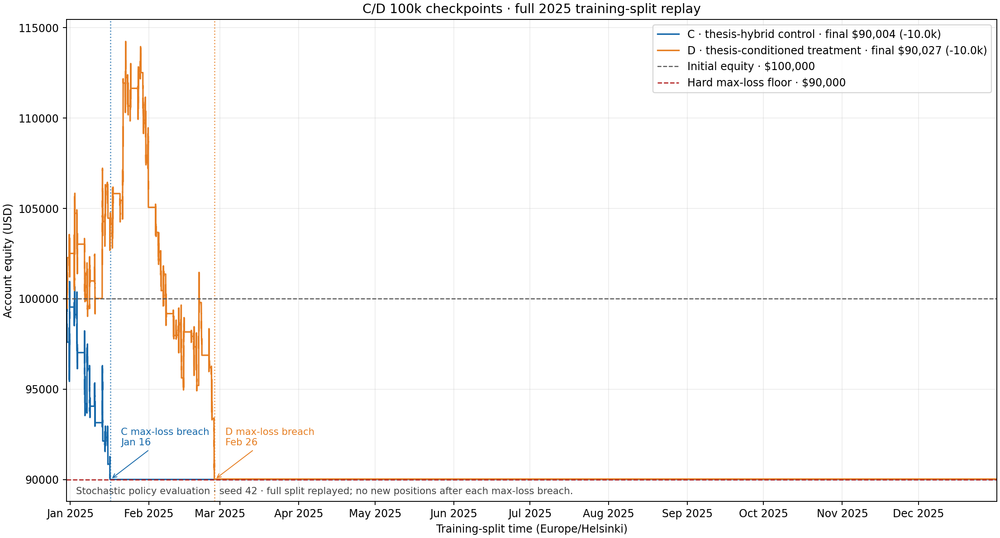

# Hybrid and setup-conditioned PPO: full training-period replay

**Purpose:** Diagnose a matched pair of 100k-step PPO checkpoints and measure
the cost of replaying the full training period.
**Result class:** Exploratory, unselected training-only evidence. This is not a 2M benchmark, a full training run, or a confirmatory test result.

## Result

Both 100k checkpoints failed the configured $10,000 maximum-loss gate during the training year. Neither recovered after the breach: the position ledger contains no new opens after the breach time, and equity remains near $90,000 for the rest of the calendar. The replay itself covered all 99,492 NY-session decision bars from 2024-12-30 through 2025-12-31.

| Measure | Hybrid control | Setup-conditioned treatment |
|---|---:|---:|
| Checkpoint training steps | 100,352 | 100,352 |
| Full training bars replayed | 99,492 | 99,492 |
| Final equity | $90,003.73 | $90,026.53 |
| Net PnL / return | −$9,996.27 / −10.00% | −$9,973.47 / −9.97% |
| First hard max-loss breach | 2025-01-16 18:39 Helsinki | 2025-02-26 20:26 Helsinki |
| Completed positions | 308 | 1,031 |
| Win rate | 44.81% | 44.03% |
| Mean PnL per position | −$32.46 | −$9.67 |
| Profit factor | 0.783 | 0.928 |
| Maximum peak-to-trough drawdown | 11.07% | 21.20% |
| Hard-breach events recorded | 4 | 8 |
| Full-year survival gate | Fail | Fail |
| Full replay wall time | 3,046.0 s (50m 46s) | 3,030.2 s (50m 30s) |

The account started at $100,000. The effective account limits were $5,000 daily loss, $10,000 maximum loss from initial equity, and no peak-trailing drawdown. The setup-conditioned policy's 21.20% maximum drawdown is measured from its within-year equity peak; it is not a breach of a peak-trailing policy because that policy was disabled. The hard $90,000 initial-equity floor was still reached.

## Monthly completed-position PnL

The split begins on December 30, so December is partial. These are position-level net PnL totals, not sums of individual partial fills.

| Month | Hybrid positions | Hybrid net PnL | Setup-conditioned positions | Setup-conditioned net PnL |
|---|---:|---:|---:|---:|
| 2024-12 (partial) | 47 | −$456.45 | 47 | +$2,511.74 |
| 2025-01 | 261 | −$9,539.82 | 563 | +$2,550.72 |
| 2025-02 | 0 | $0.00 | 421 | −$15,035.93 |
| 2025-03 through 2025-12 | 0 | $0.00 | 0 | $0.00 |
| **Total** | **308** | **−$9,996.27** | **1,031** | **−$9,973.47** |

The setup-conditioned policy's early positive equity peak was followed by a sharp February loss and the max-loss breach. The hybrid control declined from the beginning of January and breached in mid-January. These curves do not show a slow, steady decline through the entire training year: both stop opening positions after the hard loss boundary and remain flat near that boundary.

| Position outcome detail | Hybrid control | Setup-conditioned treatment |
|---|---:|---:|
| Winning / losing / breakeven positions | 138 / 170 / 0 | 454 / 576 / 1 |
| Average winner | +$261.13 | +$284.58 |
| Average loser | −$270.78 | −$241.62 |
| Gross winners | +$36,035.62 | +$129,199.54 |
| Gross losers | −$46,031.90 | −$139,173.01 |

The win rate alone is misleading. The control's average loss was slightly larger than its average win and it had more losing positions. The treatment's average winner exceeded its average loser, but it had 122 more losing than winning positions; the gross losing PnL exceeded gross winning PnL by about $9,973.

## Training behavior at 100k

At the final 98,304-transition PPO diagnostic row, both variants had finite learner values and zero invalid setup selections in the training callback. The sampled rollout diagnostics were:

| Diagnostic | Hybrid control | Setup-conditioned treatment |
|---|---:|---:|
| No-trade action rate | 87.6% | 69.6% |
| Mean setup entropy | 0.280 nats | 0.295 nats |
| Invalid setup selections | 0 | 0 |
| Explained variance | −0.25 | 0.421 |
| Approximate KL | 0.0198 | 0.0160 |

These are one-seed, short-training diagnostics. The full-replay wrapper did not preserve a per-decision setup trace, so it does not establish evaluation-time setup entropy, idea/timeframe diversity, or a setup-dependent execution effect. An empty legacy `thesis_metrics` field in the replay record means **not recorded**, not zero.

## Evaluation setup

- Action mode: stochastic, action RNG seed 42; execution seed 42.
- Initial equity: $100,000; train split: 2024-12-30 through 2025-12-31.
- Actions were sampled stochastically with action and execution seed 42.
- Initial equity was $100,000. The account used the $5,000 daily-loss limit and
  $10,000 maximum-loss limit; peak trailing drawdown was disabled.
- The replay covered the full 2025 training interval. No 2026 rows were used.
- No 2026 test/report-only data was evaluated.

The replay generated per-bar equity paths and trade ledgers containing entries,
closes, partial exits, stop changes, and rejected entry decisions. Those
run-specific outputs are separate from this readable result summary.

## Runtime decision and the attached throughput plan

This measured replay took about 50.5 minutes per arm while processing the full 2025 decision calendar. End-to-end 2M fit estimates must include this evaluation cost, the report-only evaluation, and a reserve; PPO steps per second alone are not enough.

The earlier production-path 100k training runs took 1,288 seconds for the control and 1,321 seconds for the treatment, including one dashboard replay and one best-prefix replay. The 2M lower-bound estimate was already about 6.1–6.2 hours per arm before full-split evaluation/export, so a six-hour paired allocation was not a defensible fit. This replay adds roughly another 0.85 hours per arm. **No 2M or full training was started in this result.**

The online dashboard replay was costly. Any change to evaluation cadence must
keep model-selection checkpoints and full reporting distinct, and must retain
the same action-sampling rules in a matched comparison. Deferring a report does
not fix the negative trading result.

## Interpretation and limits

The 100k checkpoints are economically nonviable under the configured account limits. The setup-conditioned treatment delayed the hard max-loss breach and generated more positions than the control, but both ended near the floor with negative net expectancy and failed the full-year survival gate. This does not identify a single cause (reward, setup selection, regime response, position sizing, or execution costs); a causal claim needs a separate controlled analysis.

This is a one-seed, 100k-step exploratory result on the training split. It is not evidence of a 2M policy outcome, does not compare independent seeds, and says nothing confirmatory about out-of-sample performance. The exposed 2026 period remains report-only.
