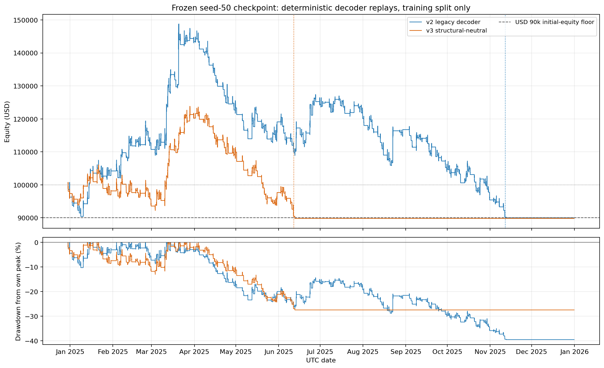

# Exit-action semantics: frozen-checkpoint result

**Decision:** Do not start the proposed fresh 2M-step pair from this evidence. The decoder mapping changes behavior, but the structural-neutral decode did not improve the complete replay and reached the hard loss floor sooner. The full fixed-entry shadow required for stronger attribution is incomplete.

## Scope and provenance

No training was run. Both arms use the same archived seed-50 checkpoint, source snapshot, deterministic evaluation policy, and full selected training interval: 2024-12-30 01:05:00+03:00 to 2025-12-31 23:49:00+03:00. The 2026 split was not evaluated.

- Archived commit: cbf7825170dee7f68ad578a19023e0847b11393f; source snapshot SHA-256: a4b3737fcf0ae9ee9329de50f461302c965d3cc97317be07fa97e2e8639910f1.
- Checkpoint SHA-256: a0dd1b68c5b8a1a2267c06d3c753fa1b9266b203dd780cd7c27cfdf0e58c5bfc; schema overlay-action-v2, 12 coordinates.
- PPO distribution: clamped_diagonal_gaussian; deterministic evaluation, seed 50. This preserves the archived convention and does not measure stochastic rollout performance.
- Execution used tick data, archived spread and five-point slippage, plus randomized fill latency capped at 30 ms. Initial seed was matched; event divergence can alter later random consumption.
- The replay source was pinned to main commit `785163c`; no tracked source or configuration files were changed to run this comparison.

## Historical reproduction

The v2 replay matched all 25 compared common text artifacts byte-for-byte, including equity, fills, trades, positions, metrics, breach events, and summaries. The checkpoint matches its archived manifest. Training bars, features, secondary series, and replayed training ticks matched their recorded identities.

The selected replay contains 351,432 bars and 56,245,046 ticks. The full raw tick identity through 2026 was not reloaded; the selected training partition was checked. The 2026 split was not evaluated.

## Action mapping

The checkpoint is Gaussian, not hybrid. Across 83,512 action-bearing v2 decisions, the raw exit output had one unique value: 0.076543249; normalized, it is 0.538272. The deterministic diagnostic action vector was constant across the replay.

- v2 selects EMA when normalized exit is at least 0.5, equivalent to raw at least 0. This selected EMA for all 1,356 v2 positions.
- The counterfactual selects EMA only at normalized 0.625, equivalent to raw +0.25. The same output selected structural mode for all 678 v3 positions.
- The archived run did not activate the exit-mode prior. The mapping issue is real; that does not establish it as the cause of the equity decline.

The first two positions matched. First economic divergence was e2:p3: both arms entered short at 21,148.8496 with stop 21,174.75. v2 closed by EMA-21 for +USD 641.02; v3 remained structural and stopped for +USD 75.19. The first same-decision v2 open rejected in v3 specifically for no valid structural TP occurred at bar 3655 on 2025-01-02 13:30 UTC. This admission comparison follows the earlier account-path divergence.

## Complete sequential replay

| Metric | v2 legacy | v3 structural-neutral |
|---|---:|---:|
| Positions | 1,356 | 678 |
| Return | -9.99% | -10.19% |
| Net PnL | USD -9,991.11 | USD -10,187.00 |
| Final equity | USD 90,008.89 | USD 89,813.00 |
| Win rate | 39.38% | 46.17% |
| Profit factor | 0.972 | 0.950 |
| Expectancy per position | USD -7.37 | USD -15.03 |
| Max peak drawdown | 39.50% | 27.46% |
| Hard-loss breach time | 2025-11-12 17:46:00+03:00 | 2025-06-12 19:11:00+03:00 |

V3 halved position count and raised win rate but had worse expectancy and profit factor. It finished USD 195.88 below v2 and breached the initial-equity loss limit about five months earlier. Its smaller maximum drawdown partly reflects stopping earlier, not full-year survival.

### Monthly net PnL

| Month | v2 net PnL | v3 net PnL |
|---|---:|---:|
| 2024-12 | USD -3,719.72 | USD -2,630.68 |
| 2025-01 | USD 7,929.04 | USD 787.85 |
| 2025-02 | USD 6,532.71 | USD -4,590.41 |
| 2025-03 | USD 32,702.36 | USD 26,668.33 |
| 2025-04 | USD -20,098.67 | USD -10,318.77 |
| 2025-05 | USD -4,255.83 | USD -12,249.33 |
| 2025-06 | USD 5,335.32 | USD -7,853.98 |
| 2025-07 | USD -4,325.01 | USD 0.00 |
| 2025-08 | USD -3,357.30 | USD 0.00 |
| 2025-09 | USD -12,009.05 | USD 0.00 |
| 2025-10 | USD -9,312.31 | USD 0.00 |
| 2025-11 | USD -5,412.66 | USD 0.00 |
| 2025-12 | USD 0.00 | USD 0.00 |

V2 peaked at USD 148,785.07 on 2025-03-20 18:55:00+00:00, not in April. The path was not a linear monthly decline: April lost about USD 20.1k, May lost USD 4.3k, June recovered USD 5.3k, then July through November lost money. December was flat after the hard-loss stop. V3 hit its stop in June; its later flat line is not continued trading evidence.

## Exit results and entry eligibility

These counts are final positions; partial target events are separate.

| Arm | Final exit reason | Win | Loss | BE | Total |
|---|---|---:|---:|---:|---:|
| v2 | ema_21_exit | 182 | 4 | 0 | 186 |
| v2 | max_drawdown | 0 | 1 | 0 | 1 |
| v2 | session_end | 14 | 2 | 0 | 16 |
| v2 | structure_sl | 338 | 813 | 2 | 1153 |
| v3 | max_drawdown | 0 | 1 | 0 | 1 |
| v3 | session_end | 4 | 3 | 0 | 7 |
| v3 | structure_sl | 225 | 360 | 1 | 586 |
| v3 | structure_tp3 | 84 | 0 | 0 | 84 |

All v2 positions were assigned EMA mode, but only 186 ended by EMA-21. 1,153 ended at the shared structural stop and 16 at session end. The loss is not simply poor EMA exits; most positions closed at stops. V3 logged 120 TP1 events, 72 TP2 events, and 84 TP3 final exits; partial exits make event counts exceed position counts.

The full original v2 entry cohort contains 1,356 positions (534 wins, 820 losses, 2 breakeven). At those exact decision times, the v3 sequential log has 427 opens, 219 rejections, and 710 timestamps with no open/rejection row. Of the rejections, 86 are specifically no-valid-TP.

Only 53 same-decision positions also match side, fill price, stop, and size. These exact pairs cover 3.9% of v2 positions and 7.8% of v3 positions. Their net PnL was USD -4,764.90 under v2 and USD 273.64 under v3, a USD 5,038.54 v3 difference. This small descriptive intersection is concentrated in March and April; it is not a full fixed-v2-entry shadow. The remaining 1,303 v2 positions comprise 374 same-decision v3 opens with a different signature, 219 same-decision v3 rejections, and 710 decision times with no v3 open/rejection row. They lack comparable same-decision v3 exit outcomes.

At same-decision times, 219 v2 opens aligned with v3 rejections and 172 v3 opens aligned with v2 rejections. Of the v2-open/v3-reject matches, 86 were specifically no-valid-TP. Other mismatches include cooldown, armed-state, and soft-brick rejections, so all reduced activity cannot be attributed to target availability.

## Risk interpretation

The effective execution policy records account floor USD 90,000.00, daily loss limit USD 5,000.00, and peak trailing drawdown limit 0%. The v2 39.50% peak drawdown was diagnostic, not an active peak stop. The failure was the USD 10,000 maximum loss from initial equity. The ledger labels this guard event max_drawdown, but the effective floor is based on initial equity, not the running peak. v2's breach-close accounting ended slightly above USD 90,000; v3 ended below the floor after the breach close.

The archived manifest also records a 7% trailing limit in its training-risk section while effective execution records zero. Reconcile this difference before another pilot.

## Root-cause decision and gates

**Confirmed:** the near-neutral Gaussian output was decoded as EMA by v2. The threshold change altered selected exit mode and entry eligibility.

**Not confirmed:** that this mapping caused the year-long loss. V3 did not restore profitability or survival; most v2 positions ended at the stop and the deterministic action vector was constant. One checkpoint/seed cannot distinguish exit decoding from entry quality, reward, architecture, regime sensitivity, or execution.

- **G0:** pass for the selected training partition; full raw-tick hash caveat is recorded above.
- **G1:** pass for this frozen closed-loop decoder contrast; no production action-schema migration was performed.
- **G2:** not met; no-go for a fresh 2M pilot because aggregate results did not improve and full fixed-entry shadow evidence is missing.
- **G3:** not reached. No 20M campaign.

Next discriminating work is a fixed-entry shadow for the full original v2 cohort on identical future ticks, with no-structural-target labels, MAE/MFE, R, holding time, exit reasons, and cost sensitivity. Neither decoder should be declared economically superior yet.

## Reproducible artifacts

- provenance.json and decision_gates.json
- counterfactual_patch.diff records the temporary decoder and CSV-export changes
- action_histograms.csv, time_slice_comparison.csv, exit_breakdown.csv
- phase2_fixed_v2_entry_cohort.csv and its summary, phase2_common_entry_cohort.csv, and phase2_unmatched_entry_cohort.csv
- Per-arm full trade and equity ledgers in each training directory
- phase2_entry_cohort.py and this report builder

The committed evidence packet contains this report, its figure, the resolved configuration, provenance and gate JSON, selected cohort ledgers, diagnostics, the counterfactual patch, and text snapshots of the analysis scripts. Full per-arm trade/equity ledgers and raw tick data remain in their original run locations and are not copied into Git.
