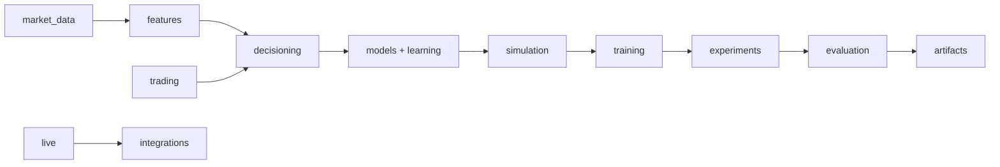

# Project tour

The framework has one main path: historical market inputs become causal
features; the environment combines those features with account state; a
policy chooses a schema-defined action; simulation applies fills and risk
rules; training updates the policy; evaluation turns a frozen policy's replay
into ledgers, metrics, and plots.

Read [architecture](../architecture/README.md) for context and package
boundaries, then follow the [module index](../modules/README.md). The
[concept pages](../concepts/README.md) explain trading and policy terms; the
[reference pages](../reference/README.md) define exact schemas.

This guide describes software flow. It does not claim that a chosen policy is
profitable, that all listed combinations are selectable, or that simulation
matches a broker in every execution detail.
