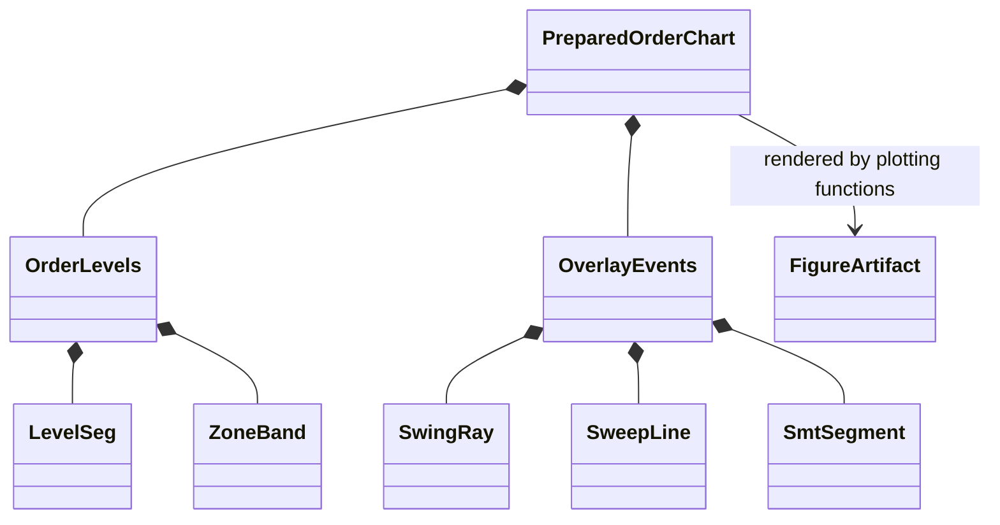

# Evaluation plotting

`evaluation/plotting/` renders views of evaluation ledgers and market context.
It organizes chart layers and presentation; it should not recompute trading
decisions, fills, risk, or performance statistics independently of the
recorded results.

## Chart inputs and layers

The order-chart path prepares candles and event overlays such as structural
levels, zones, swings, sweeps, and entries/exits. `PreparedOrderChart`,
`OrderLevels`, `LevelSeg`, `ZoneBand`, and `OverlayEvents` describe that data
before rendering. Equity, drawdown, daily PnL, distribution, comparison, and
trade-diversity plots consume report metrics or ledgers. Interactive plots add
navigation, not a different evaluation protocol.

## Configuration and truthfulness

Plot controls select visible overlays and output formats. They must not alter
the source trade ledger. If a source level is unavailable, the figure should
show that absence clearly rather than fabricate a line. Keep labels short,
inside the visible chart area, and consistent with the trade-event text report.
Store the plotting configuration beside exported evidence when it affects what
is shown.

## Extension and verification

Use the shared prepared chart/event models when adding a view so every report
uses the same geometry and timestamps. Tests are in `tests/unit/evaluation/`
and `tests/integration/`; verify empty-trade cases as well as normal outputs.
See the [evaluation guide](../../docs/modules/evaluation.md) and
[trade-setup explanation](../../docs/concepts/trade_setups.md).
