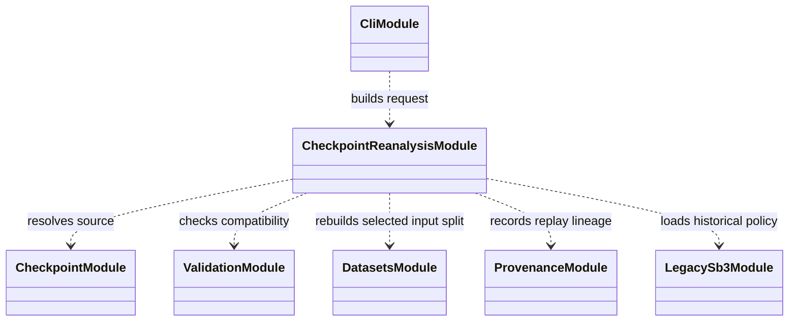

# Evaluation reanalysis

`evaluation/reanalysis/` loads preserved run/checkpoint artifacts and rebuilds
selected evaluation outputs without training the policy. It is useful for
correcting a report generator or inspecting an existing checkpoint, provided
the original run identity and compatible schema remain available.

Reanalysis must record which checkpoint, evaluation configuration, source
revision, and output directory were used. It must not overwrite the original
run record or imply that an altered replay was part of the original training
attempt. Historical checkpoint compatibility is handled explicitly at the
loading boundary.

Focused coverage is under `tests/unit/evaluation/`; the CLI-level path is
exercised by evaluation integration tests. See
[checkpoint compatibility](../../docs/reference/checkpoint_compatibility.md)
and [evaluate a checkpoint](../../docs/how-to/evaluate_checkpoint.md).

## UML module view

