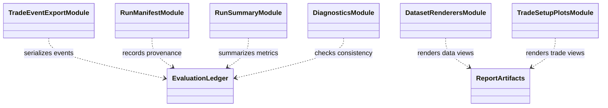

# Evaluation reporting

`evaluation/reporting/` converts canonical ledgers and metric records into
human-readable summaries and machine-readable files. It should preserve the
same sign, unit, sample, and period semantics used by the underlying metric
functions.

A report should identify the run/checkpoint, data period and role, costs,
account constraints, trade count, equity path, exits, and limitations. Figures
are evidence views; their plotted line must reconcile to the stored ledger.
When a report cannot derive a required figure, it should fail or explicitly
mark the artifact unavailable rather than silently omit it.

Tests under `tests/unit/evaluation/` and report-export tests verify table,
figure, and schema consistency. Keep text templates separate from metric
calculation and market replay. See the [metric reference](../../docs/reference/metrics.md)
and [artifact reference](../../docs/reference/artifacts.md).

## UML module view

