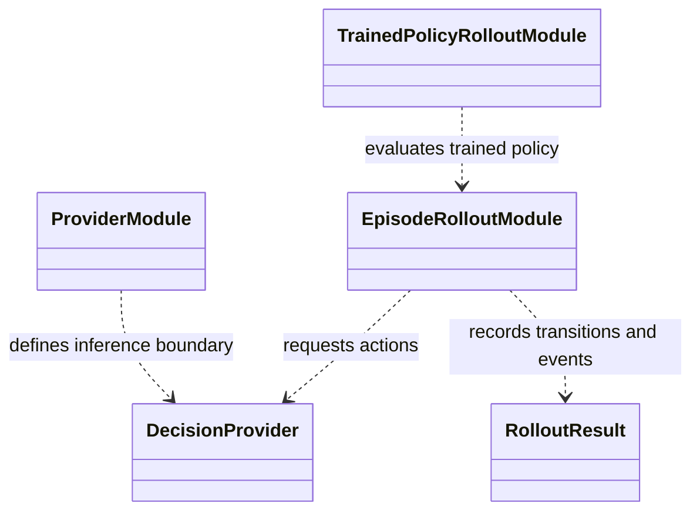

# Evaluation rollout

`evaluation/rollout/` runs a decision provider through the configured
environment over an ordered market interval. It captures transitions and
account/trade events without requiring a specific learning backend at the
provider boundary.

The rollout must use the checkpoint's observation and action contracts and
the declared data, quote, cost, and risk settings. A mismatch can produce a
valid-looking plot with invalid interpretation. The rollout output is the
common source for performance metrics, trade breakdowns, and figures; reports
should not invent a separate fill path.

Use `evaluate_provider` for provider-level evaluation and the episode runner
for one environment episode. Tests are under `tests/unit/evaluation/` and
cross-system replay coverage is in `tests/integration/`. See
[evaluation architecture](../../docs/architecture/runtime/evaluation.md) and
[checkpoint evaluation](../../docs/how-to/evaluate_checkpoint.md).

Tier 0 setup controls live in `random_eligible_setup.py`. The matched evaluator
also accepts deterministic structure rules from `structure_priority_setup.py`
and already-loaded trained policies with checkpoint/training identity. The
structure-priority rule chooses the first eligible family/timeframe in its
declared order and abstains on a long/short tie at that priority. Every arm
must use the exact environment-derived action schema and shares bars, features,
TickBook, execution seed, resolved configuration, and risk settings.
Non-synthetic runs require an explicit absolute dollar-band ceiling; the
ceiling bounds requested risk but does not make realized-risk distributions
equal. Stochastic model actions require a separate recorded seed.

`evaluation/reporting/matched_setup_baseline_bundle.py` writes the outputs as
an immutable, content-addressed draft result bundle. Trained arms must provide
checkpoint identity; deterministic rules record their policy source and rule
metadata without a fictitious checkpoint hash. The synthetic integration
fixtures validate this contract only. Each arm records moving-block
within-trajectory confidence intervals for bar-return Sharpe/Sortino/drawdown
and completed-trade win rate in `confidence_intervals.json`. These intervals
do not measure paired policy differences or between-seed variation; those
require matched return streams and independent training runs. Implementing or
wiring a baseline does not provide market-data economic evidence.

## UML module view

