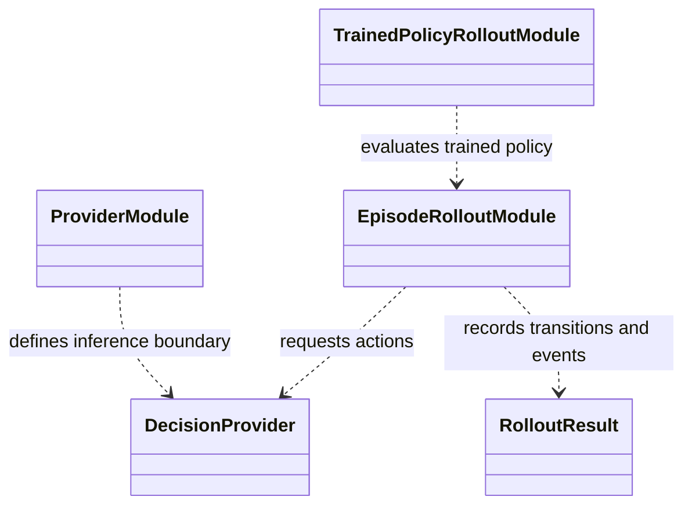

# Evaluation rollout

`evaluation/rollout/` runs a decision provider through the configured
environment over an ordered market interval. It captures transitions and
account/trade events without requiring a specific learning backend at the
provider boundary.

The rollout must use the checkpoint's observation and action contracts and
the declared data, quote, cost, and risk settings. A mismatch can produce a
valid-looking plot with invalid interpretation. The rollout output is the
common source for performance metrics, trade breakdowns, and figures; reports
should not invent a separate fill path.

Use `evaluate_provider` for provider-level evaluation and the episode runner
for one environment episode. Tests are under `tests/unit/evaluation/` and
cross-system replay coverage is in `tests/integration/`. See
[evaluation architecture](../../docs/architecture/runtime/evaluation.md) and
[checkpoint evaluation](../../docs/how-to/evaluate_checkpoint.md).

## UML module view

