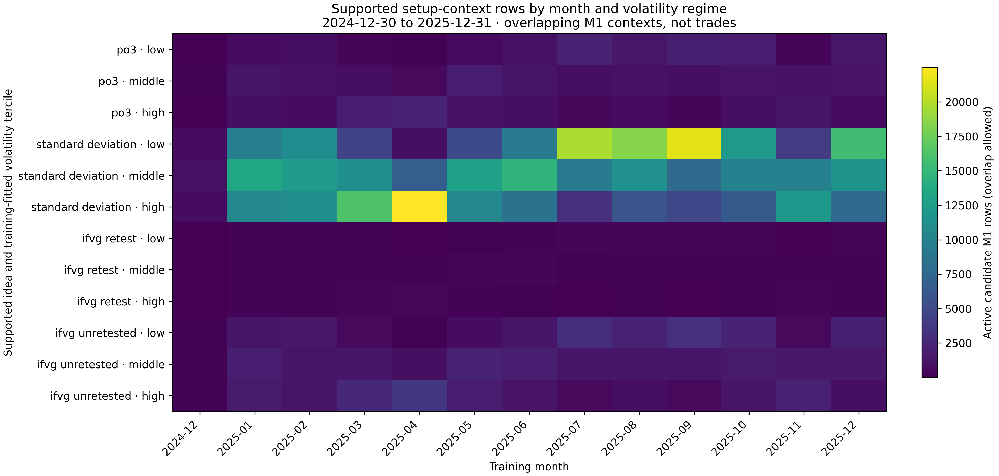

# Training-only trade-setup opportunity census

This audit counts feature eligibility contexts under the registered trade-setup overlay. It does not simulate orders, fills, positions, P&L, or policy choices.

- Training dates: 2024-12-30 through 2025-12-31 inclusive.
- Primary instrument: `US100.cash`; secondary input: `US500.cash`.
- M1 training rows: 351,432; feature-ready rows: 351,432.
- Candidate catalog: 108 setup tuples; 24 supported by the selected config and 84 unsupported by it.
- Source-event identity: 488,008 active candidate rows resolve across 109,391 candidate-scoped event IDs; missing source times are counted separately.
- Identity lifecycle counts measure contiguous source-time tuple episodes, adjacent tuple changes while a candidate remains active, and IDs reused across separate active-mask intervals; they do not establish logical event cardinality.
- Event identity contract: `trade-setup-event-identity-v3` keys each selected candidate zone by its formation/confirmation source time where applicable; same-row nonselected overlapping zones are not separate category actions.
- Ambiguous timestamp vectors are not represented in this scalar feature matrix; the row-level resolver tests that state separately.
- Event-time encoding: source columns are nullable numeric features; epoch nanoseconds pass through float64 and can round at subsecond precision. Integer keys preserve bar-time identity at the configured minute resolution but are not exact nanosecond instants or publication timestamps.
- Cross-timeframe alignment compares matching normalized integer source-time keys only for jointly active, configured candidates in the same idea and direction. Alignment is descriptive key evidence, not proof of shared logical event identity or event cardinality.
- Source-time key clusters: 108,712 family/direction/ordered-key groups across configured candidate streams; 654 occur on more than one timeframe and 378 have simultaneous multi-timeframe rows. Candidate memberships sum to 109,391; 0 groups have a candidate/timeframe count mismatch. Key equality is a conservative linkage relation, not a validated ground-truth event ontology or complete logical-event count.
- FVG retest event rows retain every M1 zone confirmation, including overlapping zones; the scalar-selection marker identifies the source zone projected by the existing feature. These detector confirmations are not candidate actions, orders, fills, or trades.
- Source config: `config/base/default.yaml` plus `config/research/trade_setup_mtf_reasoning_2m.yaml`.
- Volatility: trailing 20-M1 true range divided by close; tercile cutoffs fitted only on the in-sample rows.
- Horizon coverage: later M1 rows on the same date-derived `session_id`, not a claim of quote availability or executable trades.
- Session counts use configured `ny` labels emitted by the local data pipeline.

## Source families enabled by config

| Idea | Enabled source timeframes |
|---|---|
| `po3` | M1 |
| `order_block` | none |
| `standard_deviation` | M1, M3, M5, M10, M15, M30, H1, H4, D1 |
| `fvg_retest` | none |
| `ifvg_retest` | M1 |
| `ifvg_unretested` | M1 |

The heatmap sums active candidate rows across supported timeframes and directions. Contexts can overlap, so it is not a count of unique decisions, orders, or trades. `warmup_unknown` rows are retained in the CSVs and omitted from the plot.
The `fvg_retest_zone_event_ledger.csv`, `fvg_retest_collisions.csv`, and `fvg_retest_monthly_collision_summary.csv` files report per-zone M1 detector confirmations and scalar overlap selection by month/regime. They do not represent policy choices or trades.



Vector version: [candidate_month_regime_heatmap.pdf](candidate_month_regime_heatmap.pdf).

## Reproduction

Run from the repository root on an x86 CPU allocation with the matching environment:

```bash
.venv-x86/bin/python -m scripts.research.analysis.features.entry_idea_opportunity_census
```

The CSV files contain one row per candidate, month/regime cell, candidate/horizon pair, candidate event-identity summary, supported same-family cross-timeframe candidate pair, and family/direction/source-time key cluster. `candidate_source_time_tuple_clusters.csv` reports normalized key linkage and candidate/timeframe overlap; float-backed epoch nanoseconds can round at subsecond precision. It is not a complete ground-truth event ontology. IDs are candidate-scoped selected-source identities, not orders or trades. Identity lifecycle counters remain descriptive key/mask transitions. `resolved_config.yaml` and `census.json` record the config and source/data identities.
The FVG event files contain per-zone detector confirmations only. They record training month and volatility regime for collision rows but do not represent additional policy actions or economic opportunities.

Rebuild the heatmap from the census tables with:

```bash
.venv-x86/bin/python -m scripts.research.analysis.features.plot_entry_idea_opportunity_census
```
