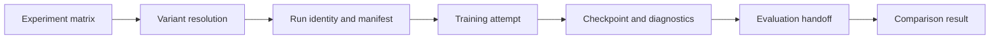

# Experiments

`experiments/` resolves variant definitions and coordinates comparable runs,
provenance, recovery, and evaluation handoff. A variant describes a configured
model/run choice; an experiment comparison defines which factors differ and
which outcomes answer the research question.

| Area | Responsibility |
|---|---|
| `variants/` | Resolve selectable configurations and model/encoder identities. |
| `campaigns/` | Coordinate run lifecycle and status. |
| `runs/`, `provenance/` | Record run identities and input/source evidence. |
| `orchestration/` | Manage multi-run workflow. |
| `cli.py` | Experiment command surface. |

Actual settings belong in configuration, not catalog prose. Do not edit a
frozen run record to make it match current defaults. Comparisons must preserve
their declared matched factors, split, seed, and execution assumptions.

See the [experiment guide](../docs/modules/experiments.md),
[generated catalog](../docs/model_variants.md), and
[research validation protocol](../docs/research/validation_protocol.md).

Every comparison family declares one research domain so results can be combined
by the question they answer:

| Domain | What belongs there |
|---|---|
| `data` | Source coverage, feature availability, and input-history treatments. |
| `environment` | Observation timing, candidate eligibility, and execution behavior. |
| `trading` | Entry, exit, sizing, and account-risk controls. |
| `representation` | Encoders and policy input representations. |
| `learning` | Reward, optimizer, action distribution, and rollout design. |

Do not force a comparison into a domain when it changes multiple unrelated
factors. Describe the bundled factors in its family entry instead.

## Run lifecycle



Declare comparisons once in `config/variant_catalog.yaml`, then reference one
or more with `comparison_families` in a run specification. The controller runs
the ordered union of their currently selectable arms and seeds under one run
identity; an arm shared by comparisons is trained once and retains each
comparison membership in the result. Use `variant_family` for a single-family
specification. Explicit `variants` may be supplied only when they exactly match
the catalog order.

Every result summary includes a row-oriented CSV with one row per run and
comparison membership. It records research domain, family, arm role, changed
factors, seed, completion status, metrics, risk outcome, and ledger
reconciliation. Shared arms produce a row in each family they serve. JSON
preserves nested evidence and Markdown provides a readable view. All three are
generated from the same validated run artifacts; the CSV is for grouping and
analysis, not variant selection.

```yaml
experiment_run_id: mtf-history-comparison
comparison_families: [mtf_encoder, policy_ladder]
seeds: [42, 43, 44]
timesteps: 2000000
data_source: frames
split: # Must match config/base/default.yaml exactly.
  train_start: '2024-12-30'
  train_end: '2025-12-31'
  test_start: '2026-01-01'
evaluation:
  locked_oos_role: final_report_only
  selection_allowed: false
  deterministic: true
```

Families are resolved from the catalog at launch. Their catalog definitions and
the run specification are included in the source snapshot and fingerprint, so
changes invalidate resume unless the existing explicit override process is
used.

Catalog labels explain research roles only. They do not override runtime YAML.
Keep historical run records immutable and create a new run identity when an
experimental factor changes. Focused tests are under
`tests/unit/experiments/`; worker lifecycle tests also live with training and
orchestration.

## Purpose

Experiments register frozen run designs, resolve variants, execute run lifecycles, and coordinate multi-run workflows.

## Public API

Use the run, variant, provenance, and orchestration interfaces under this package; reusable training behavior belongs to `training`.

## Invariants

Register configuration before use, preserve the exact run identity, and retain negative, breached, no-trade, and incomplete outcomes.
## Module size exceptions

| Module | Reason |
| --- | --- |
| `runs/execution.py` | Run dispatch binds registered configs, source identity, artifact paths, and worker lifecycle; extraction needs per-run-type identity fixtures. |
| `runs/reporting.py` | Run summaries combine account, resource, episode, and markdown outputs; extraction needs golden summaries for each supported artifact combination. |
