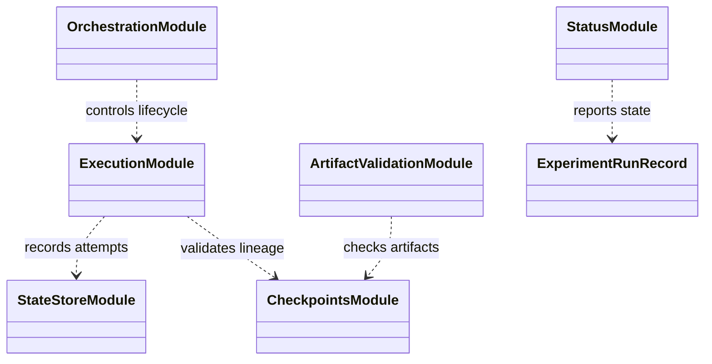

# Experiment-run lifecycle

`experiments/runs/` owns run identity, status, resume/recovery records, and
handoff between resolved variants, training, evaluation, and summaries. It
coordinates attempts; it does not change the scientific meaning of a variant
or the simulator's execution rules.

Before a run starts, the resolver and manifest should capture selected
variants, seeds, data/cache identity, source revision, budget, and effective
configuration. Recovery validates these fields and checkpoint lineage before
resuming. A new scientific factor or changed resolved setting requires a new
run identity; an infrastructure retry may remain within the same run only
when its fingerprint is unchanged and attempt history is preserved.

Focused tests are under `tests/unit/experiments/`; cross-package worker
lifecycle checks are under training and integration suites. See the
[experiment package guide](../README.md),
[reproducibility](../../docs/concepts/reproducibility.md), and
[run an experiment](../../docs/how-to/run_experiment.md).

## UML module view

