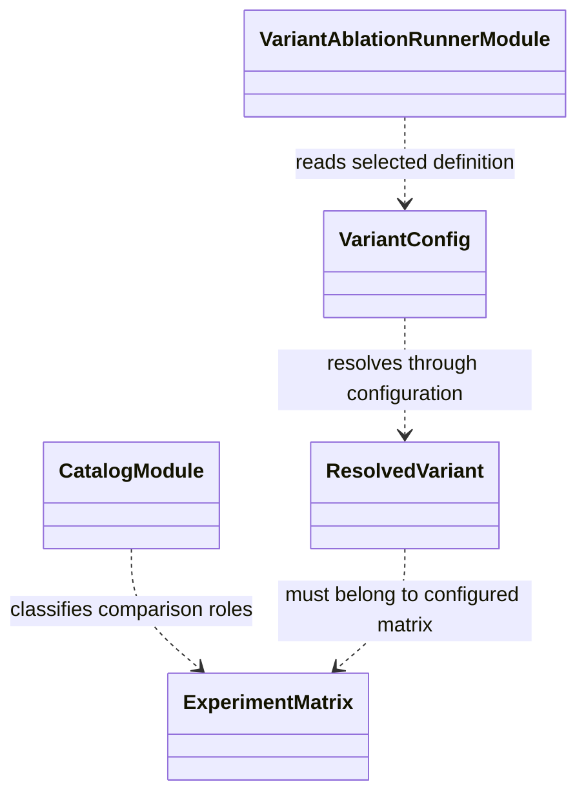

# Variant resolution and catalog

Variant resolution combines a declared experiment entry with the appropriate
configuration files and validates the result against supported algorithms,
encoders, risk settings, and action/observation options.

Catalog metadata describes family, research question, comparison role, and
changed factors. It must not duplicate hyperparameters or become another
settings source. Resolved settings belong in configuration and frozen run
records. A listed variant is selectable only when it exists in the configured
matrix and its required configuration validates.

The generated [model and experiment catalog](../../docs/model_variants.md)
must be checked after resolver or catalog metadata changes. See
[`experiments/README.md`](../README.md).

## UML module view

