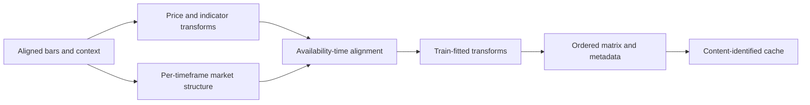

# Features

`features/` converts aligned market data into numeric observations used by
simulation, policies, and analysis. It owns feature definitions, causal
context construction, normalization boundaries, feature ordering, and cache
identity. It does not load policies or execute trades.

| Area | Role |
|---|---|
| `pipeline/` | Build and validate the ordered feature matrix. |
| `context/` | Add market-structure, session, setup-candidate, and cross-timeframe context. |
| `contracts.py`, `input_view.py` | Define feature inputs and consumer-facing views. |

Features must be causal, and fitted normalization must use training data only.
Cache identity must account for source data and feature configuration; a
version integer alone is insufficient. Preserve feature names/order as
checkpoint inputs and keep eligibility/validity separate from raw values.

## Construction stages

The pipeline owns stable column order and validity metadata. Context builders
calculate structure and candidate eligibility; the observation builder decides
which configured pieces are exposed to a model. This separation lets reports
explain candidate context without requiring the policy to trade from it.

## Extension and validation

For a new indicator or structure family, specify source timeframe, candle
completion time, units, warm-up, invalidation, and missing-value behavior. Add
prefix-invariance tests to detect future leakage and verify higher-timeframe
features cannot appear before the source bar closes. Test normalized values
with training rows fixed while evaluation inputs change. Focused tests are
under `tests/unit/features/`; cross-domain behavior is covered in integration
tests.

See the [feature guide](../docs/modules/features.md),
[data flow](../docs/architecture/data_flow.md), and
[market-structure concept](../docs/concepts/market_structure.md).
