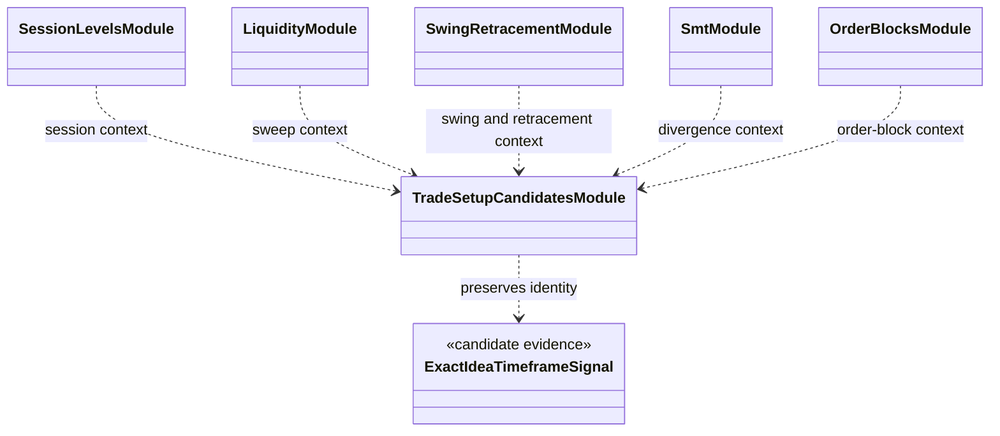

# Market context features

`features/context/` constructs contextual measurements from source bars and
completed timeframe state. These values support the model's reasoning; a
context flag is not an order and does not prove that a trade should be opened.

Current feature groups include session levels, liquidity and swings,
retracements, premium/discount, SMT, order blocks, and trade-setup candidates.
`trade_setup_candidates.py` retains exact idea/timeframe/direction semantics
instead of combining unrelated evidence into pooled eligibility flags. The
older `thesis_candidates.py` path remains as a compatibility import surface.

Feature definitions must be causal, expose validity/invalidation separately
from numeric levels where appropriate, and preserve source timeframe and
availability time. See the [market-structure concept](../../docs/concepts/market_structure.md)
and [feature pipeline](../pipeline/README.md).

## UML module view

