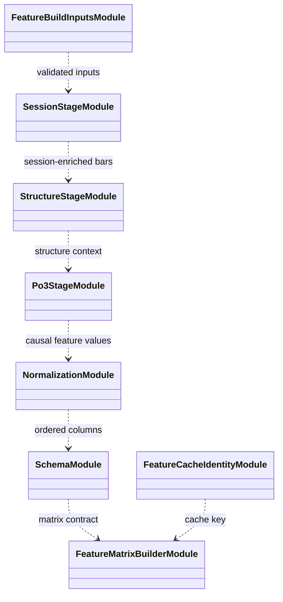

# Feature pipeline

The feature pipeline turns normalized market inputs into the named matrix
consumed by environments and evaluation. It composes input validation,
normalization, session and structure stages, schema ordering, and cache
identity.

Normalization statistics are fitted on training rows and then reused for
validation or evaluation. Timeframe values are aligned causally; feature
columns and order are preserved in manifests because they are part of the
policy input contract. Cache identity includes source and resolved feature
settings so incompatible matrices are not accidentally reused.

Use this pipeline rather than manually assembling columns in a trainer. See
[`features/README.md`](../README.md),
[observation schemas](../../docs/reference/observation_schemas.md), and
[data preparation flow](../../docs/architecture/runtime/data_and_features.md).

## UML module view

