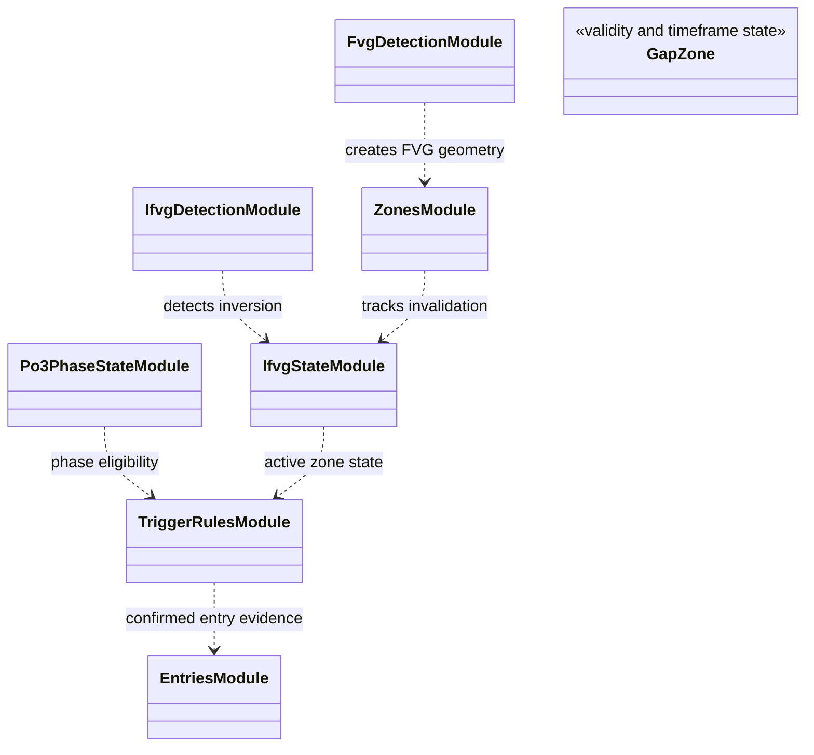

# Gap and PO3 state features

`features/po3/` constructs fair-value-gap zones, inverse-gap confirmation,
and the state/trigger information used by configured PO3 entry ideas. The
feature layer reports causal measurements and candidate evidence; it does not
create an order or make a profitability claim.

FVG/IFVG detection, zone lifecycle, phase state, and trigger construction are
separate concerns. A zone may be active, retested, invalidated, or expired;
consumers must not treat an old detected gap as permanently valid. Source
timeframe and candle-completion time determine when each state is visible.

Focused feature and state tests are under `tests/unit/features/`. Add a new
zone rule with explicit boundaries, invalidation, retest confirmation, and
prefix-invariance coverage. Plotting/report code should consume the same
records rather than reconstructing zone geometry independently. See the
[market-structure concept](../../docs/concepts/market_structure.md).

## UML module view

