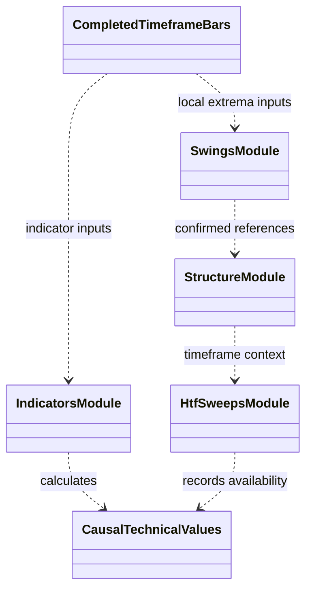

# Technical and price features

`features/technical/` computes measurements from bar series: indicators,
swings, and structural price levels. It describes price history and candidate
context; it does not decide whether the policy should enter or place an order.

Indicator periods and source timeframe are configuration inputs. Swing and
level outputs must be causal and carry enough timing/validity meaning for
consumers to distinguish active references from historical ones. Higher-time
frame calculations operate on that timeframe's own completed bars before
alignment to a decision clock.

Tests under `tests/unit/features/` cover indicators, pivots, swings,
structure, and alignment. Add new measurements with explicit units, warm-up,
missing-value rules, and source-candle availability. See the
[feature package guide](../README.md) and
[market-structure concept](../../docs/concepts/market_structure.md).

## UML module view

