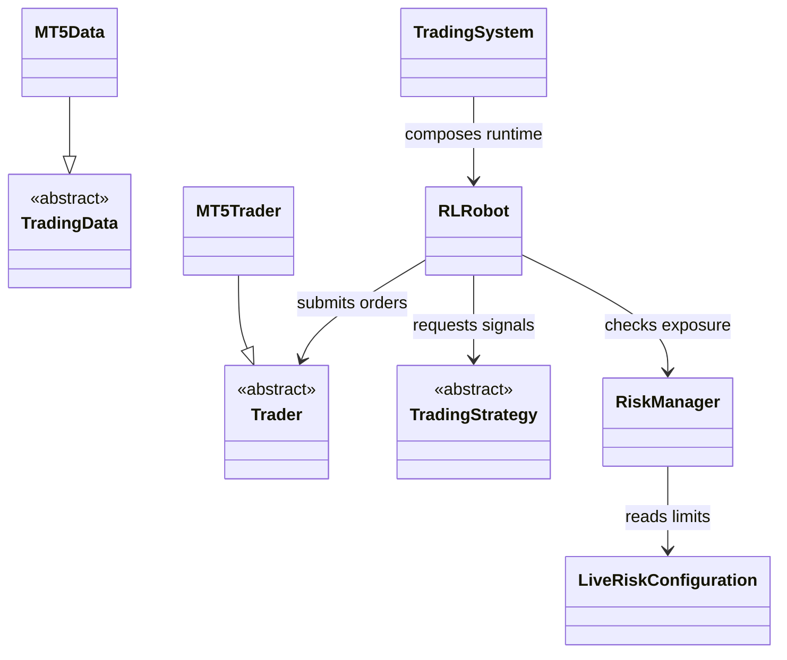

# MetaTrader integration

`integrations/mt5/` translates MetaTrader-specific data, signals, risk, and
orders into the repository's broker-neutral trading contracts. Vendor SDK
objects and account/session details stop at this boundary; the simulation,
decisioning, and evaluation packages do not depend on MetaTrader types.

## Component model

The `TradingData`, `Trader`, and `TradingStrategy` adapter interfaces isolate
data retrieval, order operations, and strategy callbacks. `MT5Data` and
`MT5Trader` implement vendor-facing behavior. `RLRobot` and the other robots
connect a strategy to order/risk services. The CLI layer composes these parts
for operator-selected symbols and runtime mode.

## Safety and configuration

Broker symbol metadata, timezones, volume steps, accepted order types, partial
fills, and rejection codes must be normalized before reaching shared domain
contracts. Live and paper risk settings must be explicit and checked against
the account currency and lot rules. A submitted order or acknowledgement is
not proof of a fill; reconcile later broker state.

## Extension and verification

Add a vendor adapter behind the existing interfaces and make retry,
idempotency, reconnection, and unsupported features explicit. Use fakes or a
broker sandbox to test timeouts, rejections, partial execution, and duplicate
requests. Focused coverage is under `tests/unit/live/` and integration tests;
live deployment is a separate operator workflow. See the
[integration guide](../../docs/modules/integrations.md).
