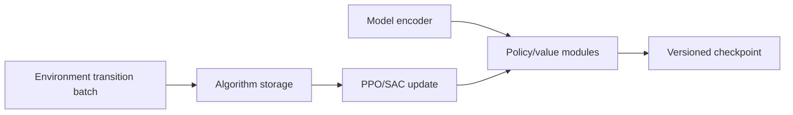

# Learning

`learning/` constructs and updates supported agents, connects model
architectures to RL algorithms, and manages policy/checkpoint compatibility.
It consumes transition batches from training and does not own market-data
preparation or account execution rules.

| Area | Responsibility |
|---|---|
| `learning/rl/` | PPO/SAC setup, policy distributions, callbacks, optimization, and model loading. |
| `learning/supervised/` | Reference-policy and supervised components used by supported workflows. |
| `learner_factory.py`, contracts | Backend-neutral learner construction and interfaces. |

An algorithm, encoder, action schema, and experiment variant are distinct
choices. Their compatibility is established by the resolver and policy
factory, not by name similarity. PPO is on-policy; SAC uses replay. Their
training diagnostics should be interpreted alongside realized account
outcomes and risk costs.

See the [learning guide](../docs/modules/learning.md),
[model architecture](../docs/architecture/model_and_policy_architecture.md),
and [action schemas](../docs/reference/action_schemas.md).

## Training boundary

PPO collects on-policy rollouts and updates against the policy that generated
them; SAC stores transitions for off-policy replay. Callbacks can report
diagnostics or shape supported risk costs, but the environment remains the
authority for hard account limits. The learner should not redefine fill,
position, or reward accounting.

## Extension and verification

Add algorithm setup behind the learner factory and explicit backend contract.
Verify action distribution log-probability and entropy behavior, masks,
checkpoint resume, and deterministic inference where applicable. Focused
coverage is under `tests/unit/learning/`; end-to-end transition-to-update tests
live in integration/smoke suites. Learning reward and financial outcome are
separate evidence and must both be reported.
