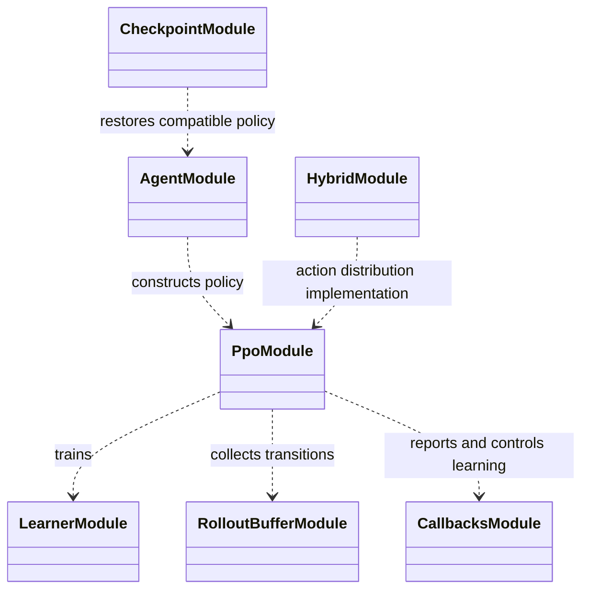

# Reinforcement-learning implementation

`learning/rl/` connects supported algorithms to encoders, policy/value
distributions, rollout data, callbacks, and checkpoint loading.

The main responsibilities are separated across agent/policy construction,
PPO/SAC setup, custom semantic or hybrid distributions, rollout-buffer
integration, learning diagnostics, stopping rules, and compatibility
validation. An algorithm comparison should not silently change action
semantics or the execution environment.

For masked categorical setup choices, the same valid-action mask must govern
both sampling and evaluation of stored actions. Checkpoint compatibility
includes policy class paths and action/observation metadata. See
[`learning/README.md`](../README.md),
[action schemas](../../docs/reference/action_schemas.md), and
[checkpoint compatibility](../../docs/reference/checkpoint_compatibility.md).

## UML module view

