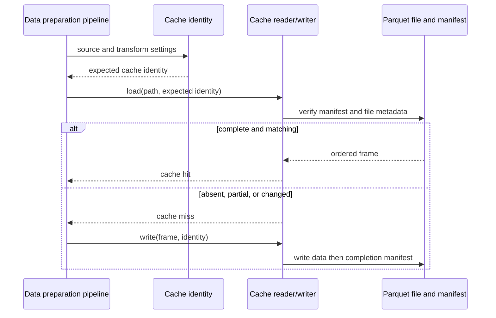
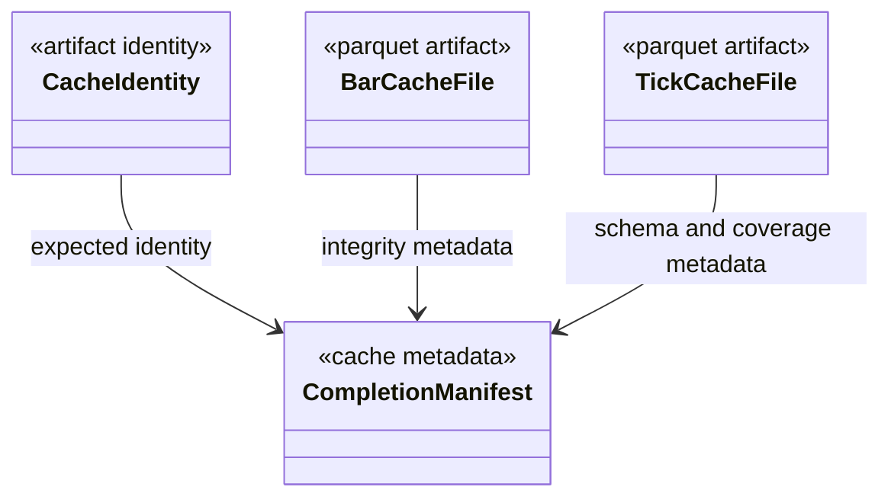

# Market-data caches

`market_data/cache/` stores reusable bar and tick data with an explicit
identity and a completion record. A cache is accepted only when its recorded
input identity and basic file-integrity checks still match; the presence of a
Parquet file alone does not make it reusable.

## Data contract

Bar and tick identities include the relevant source identity, transform or
symbol/timeframe settings, and schema version. The identity is derived through
the shared artifact-identity helper. Parquet manifests record row count,
ordering endpoints, file size, modification time, and inode. Tick cache
manifests also describe the tick schema and source coverage. Invalid, partial,
or mismatched cache entries are treated as cache misses so the caller can
rebuild them from authoritative inputs.

## Read and write lifecycle

The writer publishes the completion metadata only after writing the data file.
Readers validate identity, file metadata, row count, and chronological order
before returning a frame. They do not decide the train/test split or fit feature
normalization; those belong to the market-data and feature pipelines.

## Extension and verification

When adding a cache kind, define a stable identity from all settings that can
change its contents, version the serialized schema when its meaning changes,
write data atomically before declaring completion, and make stale entries a
miss. Keep source data and cache outputs separate. Focused checks are in
`tests/unit/market_data/`, including tick cache identity and completion cases.

See [market data](../README.md), [cache identity](../../docs/concepts/reproducibility.md),
and the [cache preparation how-to](../../docs/how-to/prepare_market_data.md).

## UML module view

