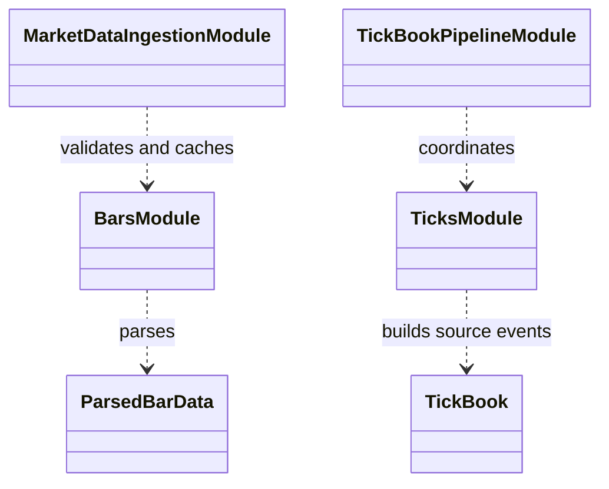

# Market-data loading

This package area turns source exports into validated bar and tick structures
with stable source/cache identity.

| Component | Role |
|---|---|
| `bars.py`, `market_data_ingestion.py` | Read, validate, and cache bar inputs. |
| `ticks.py`, `tick_book_pipeline.py` | Read tick events and build quote/book views for execution. |

Loading establishes parsed timestamps and structural validity; timeframe
alignment, sessions, and data splits are handled by
[`../transforms/README.md`](../transforms/README.md). The source identity and
cache completion metadata must match before reuse. Avoid making a malformed
or partial cache look complete by publishing it before validation finishes.

See the [market-data overview](../README.md) and
[reproducibility concept](../../docs/concepts/reproducibility.md).

## UML module view

