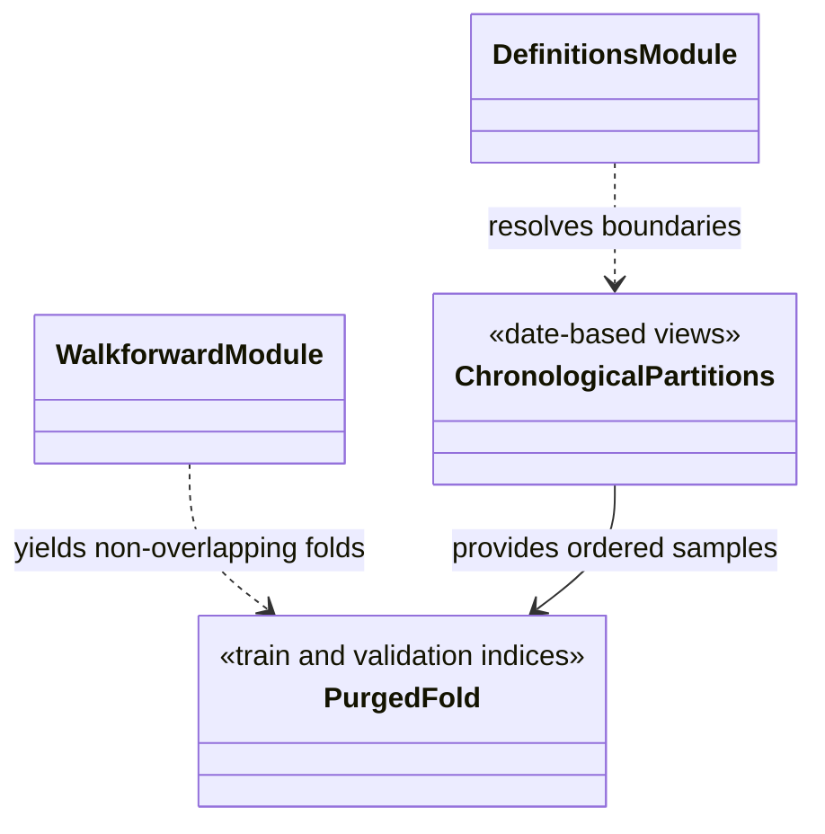

# Chronological data splits

`market_data/splits/` defines date-based partitions, training masks, and
purged walk-forward folds. It assigns the role of each timestamp; it does not
fit features, select a model, or decide whether a period is scientifically
untouched.

The standard split boundary is defined by configuration. Warm-up rows may be
available to causal feature builders while remaining excluded from policy
training through a training mask. Walk-forward validation creates ordered
train/validation views with purge and embargo rules so nearby labels or feature
windows do not silently overlap. The current non-overlapping test folds and
deprecated legacy stepper are distinct APIs; use the current function unless
reproducing a recorded historical analysis.

When changing inclusivity or purge behavior, test exact boundary timestamps,
short input periods, and non-overlap across folds. Focused coverage is under
`tests/unit/market_data/`; feature-fitting scope is tested under
`tests/unit/features/`. See the [validation protocol](../../docs/thesis/validation_protocol.md)
for research-period roles.

## UML module view

