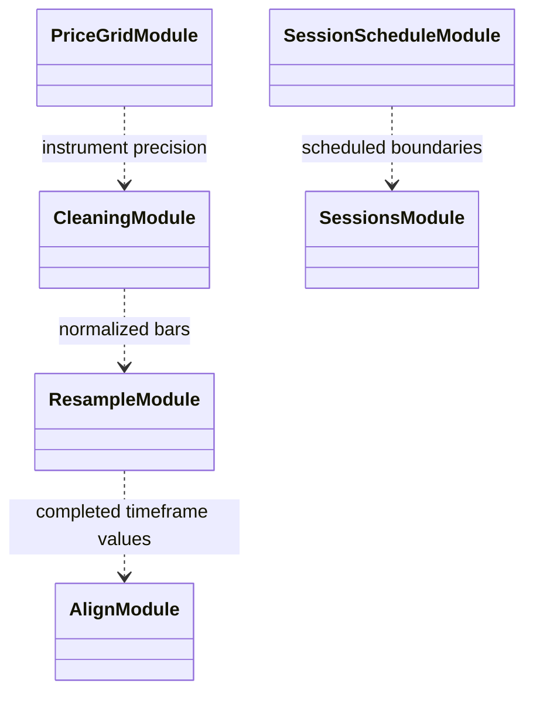

# Market-data transforms

Transforms align data to the decision clock and define resampling, cleaning,
price-grid, session, and split behavior. Their ordering is a scientific
correctness boundary because a future or incomplete candle must not enter an
earlier observation.

| Component | Role |
|---|---|
| `resample.py`, `align.py` | Build timeframe bars and causally align completed values. |
| `cleaning.py`, `price_grid.py` | Normalize market values and instrument precision. |
| `sessions.py`, `session_schedule.py` | Define session context and scheduled boundaries. |
| Split definitions | Preserve chronological training/validation/test roles. |

Changes require tests for timezone/DST, timeframe completion, missing rows,
session boundaries, and chronological split inclusivity. See
[market data](../README.md), [data flow](../../docs/architecture/runtime/data_and_features.md),
and the [validation protocol](../../docs/thesis/validation_protocol.md).

## UML module view

