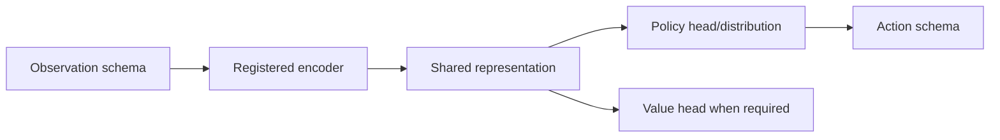

# Models

`models/` provides reusable neural components and observation encoders. It
does not own PPO/SAC optimization, environment transitions, or trade semantics.
Learning code composes model components with policies and value functions.

| Area | Responsibility |
|---|---|
| `encoders/` | Temporal, recurrent, transformer, and multi-timeframe representations. |
| `architecture_ids.py` | Lightweight identifiers used before importing a model implementation. |
| Policy components | Reusable heads and distributions where exposed by the current model registry. |

Supported encoder IDs and their actual configured combinations are listed in
the generated [model and experiment catalog](../docs/model_variants.md). An
encoder ID is not an algorithm or a complete agent. Checkpoint class paths and
observation schemas are compatibility concerns; preserve old imports when
serialized checkpoints require them.

See the [model guide](../docs/modules/models.md),
[model architecture](../docs/architecture/model_and_policy_architecture.md),
and [checkpoint compatibility](../docs/reference/checkpoint_compatibility.md).

## Model composition

`architecture_ids.py` is intentionally lightweight so configuration and
variant validation do not need to import Torch. The factory is the executable
implementation registry. Both registries must agree, and a catalog entry is
selectable only if the full algorithm, observation, policy, and action
combination resolves.

## Extension and validation

Keep tensor shape/sequence assumptions explicit and preserve module constructor
parameters needed by checkpoint loading. Add focused tests for shapes, masks,
gradients, device/dtype behavior, and serialization. Encoder tests are under
`tests/unit/models/`; learner-policy compatibility is covered under
`tests/unit/learning/`.
