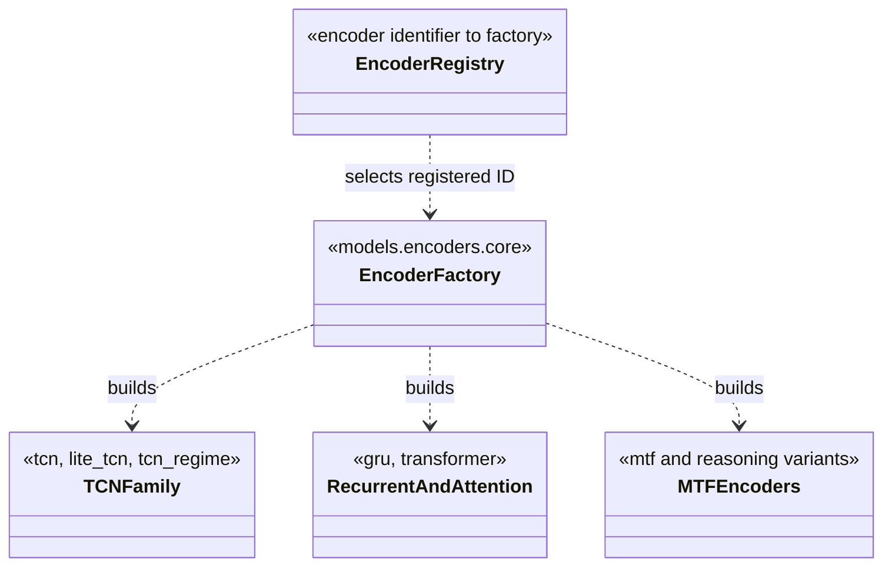

# Observation encoders

Encoders map versioned observation branches to latent representations used by
policy and value heads. They do not define the RL update algorithm or the
meaning of actions.

Supported architecture identifiers currently include temporal convolution
(`tcn`, `lite_tcn`, `tcn_regime`), recurrent (`gru`), transformer
(`transformer`), and multiple timeframe families (`mtf`, `mtf_reasoning`,
`mtf_shared_tcn_reasoning`, `mtf_m1_tcn_htf_lite_reasoning`, and
`mtf_m1_tcn_htf_snapshot_reasoning`). The generated model catalog describes
which of these are actually configured with each algorithm and policy schema.

Multi-timeframe encoders consume explicit sequence branches and masks; they
must not assume that repeated M1 feature rows are independent higher-timeframe
candles. Input widths, window settings, and optional branches must agree with
the resolved observation schema and checkpoint metadata.

See [model architecture](../../docs/architecture/model_and_policy_architecture.md)
and the [model catalog](../../docs/model_variants.md).

## Encoder families

| Family | Identifiers | Architectural role |
|---|---|---|
| Temporal convolution | `tcn`, `lite_tcn`, `tcn_regime` | Extract local temporal patterns from a sequence; regime-aware inputs add context through their declared observation branch. |
| Recurrent | `gru` | Update a hidden state over ordered observations. |
| Attention | `transformer` | Relate sequence positions through attention, subject to the configured causal/masking contract. |
| Multi-timeframe | `mtf`, `mtf_reasoning`, and the registered shared/M1-plus-HTF variants | Process distinct timeframe windows or context branches and combine their representations. |

Names summarize family, not guaranteed model quality. Some MTF variants share
an encoder trunk; others use separate or summarized higher-timeframe paths.
Read the generated catalog for configured comparisons and the matching
architecture module for the exact implementation. Do not infer selectable
combinations from this family table alone.

## Input and checkpoint contract

Each encoder declares the observation keys it consumes. Multi-timeframe input
branches contain their own windows and masks; repeating M1 features to mimic a
completed M5/H1 bar changes temporal meaning and can introduce leakage. Preserve
branch lengths, feature widths, mask semantics, and constructor settings in
checkpoint metadata. Tests under `tests/unit/models/` cover encoder behavior;
schema and policy integration tests cover the full observation path.

## UML module view

