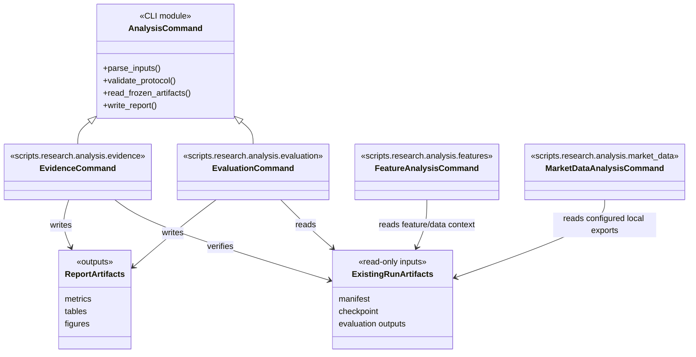

# Research analysis tools

This package contains reproducible analysis, reporting, and evidence-checking
commands used to inspect existing experiment outputs. It does not train models
or rewrite source run records. Each command accepts explicit input/output paths;
read its `--help` and the referenced protocol before running it.

## Areas

| Area | Responsibility |
|---|---|
| `features/` | Reusable feature, candidate, and observation-context analyses. Commands call the production `features/` APIs; they do not duplicate feature implementations. |
| `market_data/` | Reusable local-source quality, timeframe, and availability analyses. Data cleaning and transformation behavior remains in production `market_data/`. |
| `evaluation/` | Evaluate checkpoints, compare outcomes, run fixed-entry replay analyses, and reconcile recorded decision/fill/position events. |
| `evidence/` | Reconcile manifests, ledgers, provenance, and numerical report claims. |
| `models/` | Reusable audits of model inputs, tensor shapes, encoders, and architecture behavior. |
| `decisioning/` | Candidate catalogs, masks, observation/action schemas, and candidate-to-action semantics. |

For an archived campaign output root, use
`scripts/research/analysis/evidence/inventory_archived_config_snapshots.py` to
separate actual training-attempt configs from report/replay and reanalysis
snapshots. It deduplicates symlink aliases by resolved config file and labels
missing saved fields `not_saved` rather than filling them from current defaults.



The diagram shows command responsibilities and artifact flow, not a shared
runtime inheritance hierarchy. Reusable trading and data-transform behavior
belongs in the owning production packages; these domain folders contain
repeatable analysis workflows around those APIs. Unit coverage is under
`tests/unit/research/`; protocol-level checks are under `tests/research/`.

## Where a new tool belongs

Choose the folder by the question the command answers, not by whether its
filename contains `audit`, `check`, or an experiment label. A repeatable
feature investigation belongs in `features/`; source coverage and bar
alignment work in `market_data/`; encoder and model-input questions in
`models/`; candidate and action contracts in `decisioning/`; result
comparisons in `evaluation/`; and lineage or release evidence in `evidence/`.
Keep `scripts/research/audits/` for release gates, protocol enforcement,
holdout-exposure controls, and narrow pass/fail verifiers.

Prefer one parameterized command that accepts a config, input artifact, and
output path over one Python file for each run or experiment. Put behavior used
by training, evaluation, or production in its owning package (for example
`features/`, `market_data/`, `models/`, or `decisioning/`); analysis commands
should call that behavior rather than fork it. Keep run IDs and dates in
artifact metadata, not in canonical tool or report names.

For bounded recovery searches inside research ZIPs,
`scripts/research/analysis/evidence/search_archive_trace_contents.py` reads at most 64 KiB from each
CSV/TSV/JSON/JSONL/YAML/text/log member and reports likely candidate,
decision, and order-trace field combinations without extracting files. A
match is only a lead for lineage review; a zero-match result is scoped to the
supplied root, formats, and inspected prefixes. The current local archive
search and its exact limits are recorded in
`evidence/research/historical_variant_screen_recoverability/`.

For a preregistered treatment-versus-no-trade campaign, use
`scripts/research/analysis/evidence/plan_paired_seed_count.py` to convert a
declared minimum effect and paired-seed standard deviation into a bounded
fixed count. It uses a one-sided noncentral-t approximation, records that
assumption, and does not authorize or launch a campaign; confirmatory inference
still uses the project's paired sign-flip and bootstrap protocol.

```bash
.venv/bin/python scripts/research/analysis/evidence/search_archive_trace_contents.py \
  --root /scratch/work/nguyenl37/Quantitative-RL-Trading-System-research-archive \
  --out evidence/research/historical_variant_screen_recoverability/archive_trace_content_search.json
```

For a selected campaign, `evidence/verify_selected_campaign_artifacts.py`
rechecks the campaign fingerprint, source snapshot and every file in its
embedded source manifest, then verifies each run manifest, resolved config,
and final checkpoint against current bytes. It checks that campaign and run
source commits follow the current repository history. It does not rehash raw
market data, recover an unavailable feature cache, load a model, or replay a
checkpoint. The selected P6 packet is recorded in
`evidence/research/releases/negative-evidence-readiness/selected_campaign_artifact_integrity.json`:

```bash
.venv/bin/python scripts/research/analysis/evidence/verify_selected_campaign_artifacts.py
```

For candidate price-input feasibility, run
`scripts/research/analysis/features/candidate_geometry_support.py` with a
training config and a new `--output-dir`. It verifies configured local inputs,
uses production feature builders, and reports active source-zone or
retracement-band bounds by candidate. Its v3 report also scales widths and
distance from the aligned M1 close by M1 ATR. This is feature-analysis
evidence only: it does not define candidate orders, labels, fills, or economic
utility. The selected-profile output is in
`evidence/research/candidate_geometry_price_scale/`.

```bash
.venv/bin/python -m scripts.research.analysis.features.candidate_geometry_support \
  --config config/research/trade_setup_mtf_reasoning_2m.yaml \
  --output-dir evidence/research/candidate_geometry_price_scale
```

After the candidate conditional outcome packet passes structural verification,
`scripts/research/analysis/evaluation/audit_candidate_outcome_replay_sample.py`
replays one deterministic row per recorded entry-type/status/reason stratum
through the versioned execution function and records exact field comparisons.
This is a repeatability audit, not an independent implementation or a
full-row recalculation. Then
`scripts/research/analysis/evaluation/plot_candidate_outcome_coverage.py`
builds status-disposition tables by proposal type, candidate, and UTC signal
month, plus a candidate-by-month unresolved-share heatmap. The figures treat
bracket combinations as conditional rows, not independent trades or policy
outcomes, and write source/output hashes into the packet:

```bash
.venv/bin/python -m scripts.research.analysis.evaluation.audit_candidate_outcome_replay_sample
.venv/bin/python -m scripts.research.analysis.evaluation.verify_candidate_proposal_outcomes
.venv/bin/python -m scripts.research.analysis.evaluation.plot_candidate_outcome_coverage
.venv/bin/python -m scripts.research.analysis.evaluation.verify_candidate_proposal_outcomes
```

For a deterministic full replay, `scripts/research/analysis/evaluation/compare_candidate_outcome_replays.py`
compares the Parquet schema and every Arrow row in bounded batches. It records
both file hashes and any mismatch. This confirms reproducibility only when the
same production replay implementation generated both files; it does not
independently verify execution semantics.

```bash
.venv/bin/python -m scripts.research.analysis.evaluation.compare_candidate_outcome_replays \
  --replay /scratch/work/.../candidate-outcomes-full-replay-repeat/conditional_outcomes.parquet \
  --report /scratch/work/.../candidate-outcomes-full-replay-repeat/full_replay_comparison.json
```

When the report is copied to
`evidence/research/candidate_outcomes/full_replay_value_comparison.json`, the
packet verifier checks its exact row count and canonical-table hash, then
includes the comparison report in `OUTPUT_SHA256SUMS` and its own machine
report. This remains same-implementation reproducibility evidence.

For a recovered tick-backed run, `scripts/research/analysis/market_data/analyze_fill_quote_source_alignment.py`
streams the selected event ledger and MT5 tick export to count filled entries
and exits that land in source timestamp groups with missing quote sides,
parser-carried sides, or changed quote values at a tied timestamp. Specify the
configured timezone explicitly; the report preserves that as a join setting
and does not claim the source clock or within-timestamp chronology. Example:

```bash
.venv-x86/bin/python scripts/research/analysis/market_data/analyze_fill_quote_source_alignment.py \
  --events-csv outputs/.../training/fills.csv \
  --ticks-csv data/training/US100.cash_202412300105_202610162349.csv \
  --source-timezone Etc/GMT-3 \
  --out evidence/research/releases/negative-evidence-readiness/fill_quote_source_alignment.json
```

For a recorded policy lifecycle, `scripts/research/analysis/evaluation/summarize_policy_trade_lifecycle.py`
joins `trades.csv`, `fills.csv`, and `positions.csv` by position ID. It reports
timestamp ordering, fill/position and net-PnL reconciliation, holding time,
and exit reasons without replaying a model or scanning market data:

```bash
.venv-x86/bin/python scripts/research/analysis/evaluation/summarize_policy_trade_lifecycle.py \
  --run-dir outputs/.../training \
  --output-dir evidence/research/selected_policy_trade_lifecycle
```

When an excursion ledger already exists, `scripts/research/analysis/evaluation/summarize_trade_exit_cohorts.py`
groups position outcomes by arm and recorded exit reason without rebuilding a
TickBook. It accepts repeatable `--arm NAME=CSV` inputs and writes a JSON
provenance summary plus a CSV cohort table. The report keeps realized net R
separate from price-only MFE/MAE and explicitly marks distinct arms as
unpaired; it does not estimate an alternative exit or causal effect. Its
current historical use is recorded in
`evidence/research/failure_mechanisms/`.

For a saved matched-baseline bundle,
`scripts/research/analysis/evaluation/build_matched_baseline_flow_summary.py`
verifies the declared decision-trace and fill-ledger hashes, counts decision,
candidate-selection, rejection, opening, and terminal-position records by arm,
and verifies decision-ID links for every open event. It leaves broker order
attempts and acceptances unavailable when the artifacts do not record them.
The generated scope is kept separate from historical policy and raw-data
denominators in `evidence/research/pipeline_denominators/`.

For a bounded follow-up to the local archive content-prefix scan,
`scripts/research/analysis/evidence/search_nested_archive_traces.py` inspects
ZIP-based members inside local ZIP archives without extracting or
deserializing checkpoint payloads. It applies a configurable maximum size to
nested containers and searches only bounded prefixes of supported text files.
Its zero-match result is limited to the inspected root, formats, and prefixes;
oversize or unreadable containers stay explicit in the report.

`scripts/research/analysis/evidence/inventory_scratch_symlinks.py` inventories
link targets without traversing linked directories. Use repeated
`--focus-name` options to retain detailed records for research workspaces while
reporting other top-level symlinks as counts. This identifies paths that need
a separate scan; it does not treat target existence as proof of evidence
completeness.
