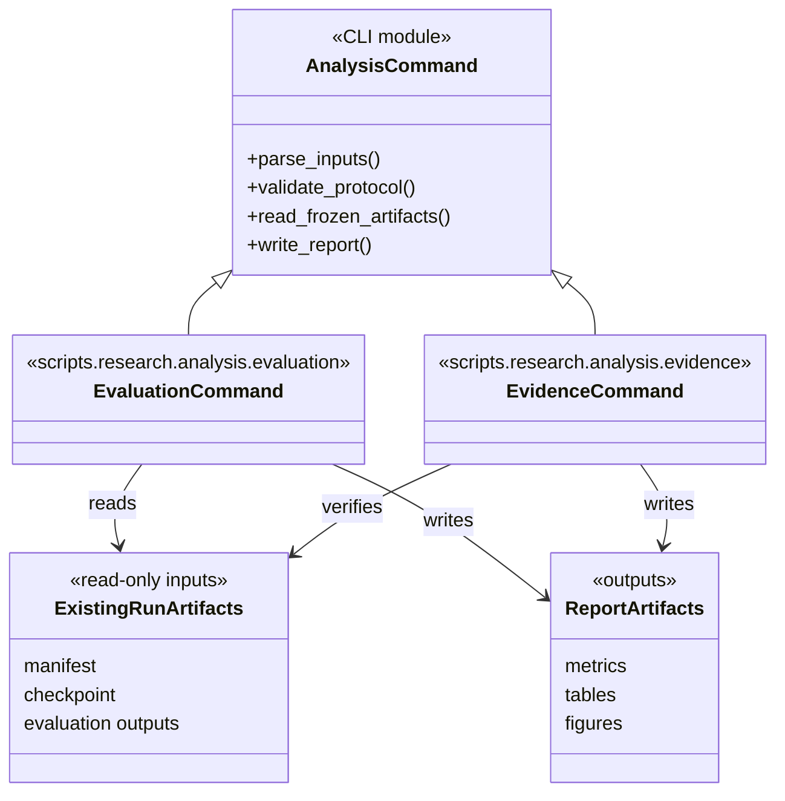

# Research analysis tools

This package contains reproducible analysis, reporting, and evidence-checking
commands used to inspect existing experiment outputs. It does not train models
or rewrite source run records. Each command accepts explicit input/output paths;
read its `--help` and the referenced protocol before running it.

## Areas

| Area | Responsibility |
|---|---|
| `evaluation/` | Evaluate checkpoints and render comparable result summaries and figures. |
| `evidence/` | Reconcile manifests, ledgers, provenance, and numerical report claims. |
| Package-level modules | Focused research analyses that do not fit either command group. |

The diagram shows command responsibilities and artifact flow, not a shared
runtime inheritance hierarchy. Reusable trading behavior belongs in the owning
production packages, not here. Unit coverage is under `tests/unit/research/`;
protocol-level checks are under `tests/research/`.
