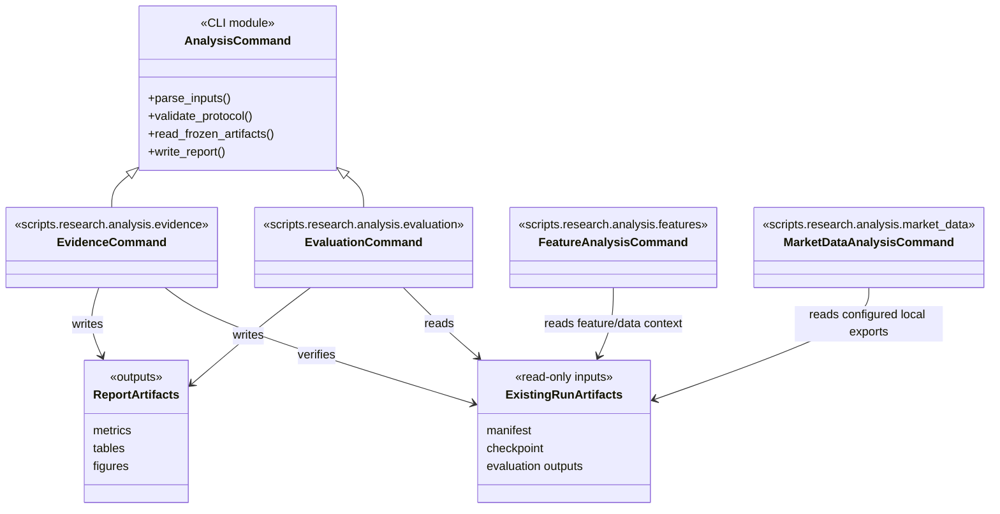

# Research analysis tools

This package contains reproducible analysis, reporting, and evidence-checking
commands used to inspect existing experiment outputs. It does not train models
or rewrite source run records. Each command accepts explicit input/output paths;
read its `--help` and the referenced protocol before running it.

## Areas

| Area | Responsibility |
|---|---|
| `features/` | Reusable feature, candidate, and observation-context analyses. Commands call the production `features/` APIs; they do not duplicate feature implementations. |
| `market_data/` | Reusable local-source quality, timeframe, and availability analyses. Data cleaning and transformation behavior remains in production `market_data/`. |
| `evaluation/` | Evaluate checkpoints, compare outcomes, run fixed-entry replay analyses, and reconcile recorded decision/fill/position events. |
| `evidence/` | Reconcile manifests, ledgers, provenance, and numerical report claims. |
| `models/` | Reusable audits of model inputs, tensor shapes, encoders, and architecture behavior. |
| `decisioning/` | Candidate catalogs, masks, observation/action schemas, and candidate-to-action semantics. |



The diagram shows command responsibilities and artifact flow, not a shared
runtime inheritance hierarchy. Reusable trading and data-transform behavior
belongs in the owning production packages; these domain folders contain
repeatable analysis workflows around those APIs. Unit coverage is under
`tests/unit/research/`; protocol-level checks are under `tests/research/`.

## Where a new tool belongs

Choose the folder by the question the command answers, not by whether its
filename contains `audit`, `check`, or an experiment label. A repeatable
feature investigation belongs in `features/`; source coverage and bar
alignment work in `market_data/`; encoder and model-input questions in
`models/`; candidate and action contracts in `decisioning/`; result
comparisons in `evaluation/`; and lineage or release evidence in `evidence/`.
Keep `scripts/research/audits/` for release gates, protocol enforcement,
holdout-exposure controls, and narrow pass/fail verifiers.

Prefer one parameterized command that accepts a config, input artifact, and
output path over one Python file for each run or experiment. Put behavior used
by training, evaluation, or production in its owning package (for example
`features/`, `market_data/`, `models/`, or `decisioning/`); analysis commands
should call that behavior rather than fork it. Keep run IDs and dates in
artifact metadata, not in canonical tool or report names.

For a recovered tick-backed run, `scripts/research/analysis/market_data/analyze_fill_quote_source_alignment.py`
streams the selected event ledger and MT5 tick export to count filled entries
and exits that land in source timestamp groups with missing quote sides,
parser-carried sides, or changed quote values at a tied timestamp. Specify the
configured timezone explicitly; the report preserves that as a join setting
and does not claim the source clock or within-timestamp chronology. Example:

```bash
.venv-x86/bin/python scripts/research/analysis/market_data/analyze_fill_quote_source_alignment.py \
  --events-csv outputs/.../training/fills.csv \
  --ticks-csv data/training/US100.cash_202412300105_202610162349.csv \
  --source-timezone Etc/GMT-3 \
  --out evidence/research/releases/negative-evidence-readiness/fill_quote_source_alignment.json
```

For a recorded policy lifecycle, `scripts/research/analysis/evaluation/summarize_policy_trade_lifecycle.py`
joins `trades.csv`, `fills.csv`, and `positions.csv` by position ID. It reports
timestamp ordering, fill/position and net-PnL reconciliation, holding time,
and exit reasons without replaying a model or scanning market data:

```bash
.venv-x86/bin/python scripts/research/analysis/evaluation/summarize_policy_trade_lifecycle.py \
  --run-dir outputs/.../training \
  --output-dir evidence/research/selected_policy_trade_lifecycle
```

When an excursion ledger already exists, `scripts/research/analysis/evaluation/summarize_trade_exit_cohorts.py`
groups position outcomes by arm and recorded exit reason without rebuilding a
TickBook. It accepts repeatable `--arm NAME=CSV` inputs and writes a JSON
provenance summary plus a CSV cohort table. The report keeps realized net R
separate from price-only MFE/MAE and explicitly marks distinct arms as
unpaired; it does not estimate an alternative exit or causal effect. Its
current historical use is recorded in
`evidence/research/failure_mechanisms/`.
