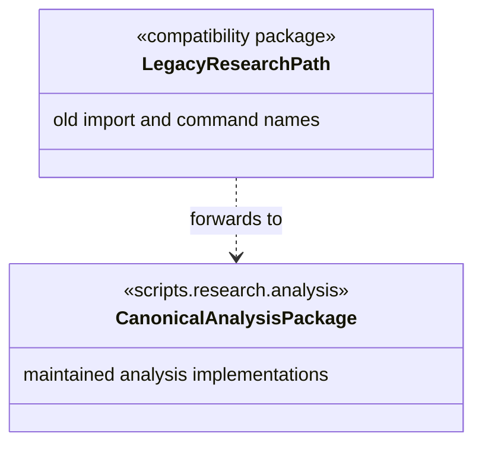

# Legacy research command paths

This package is retained only as a compatibility layer for old imports and
command paths recorded in run metadata, shell histories, or external reports.
Each Python module forwards to the canonical implementation in
[`scripts/research/analysis/`](../analysis/README.md). New code, documentation,
and maintained launch scripts must use `scripts.research.analysis`.

The `thesis` segment in this compatibility path is not a separate research
subsystem and does not own implementations. Do not add new tools here.

## UML module view

