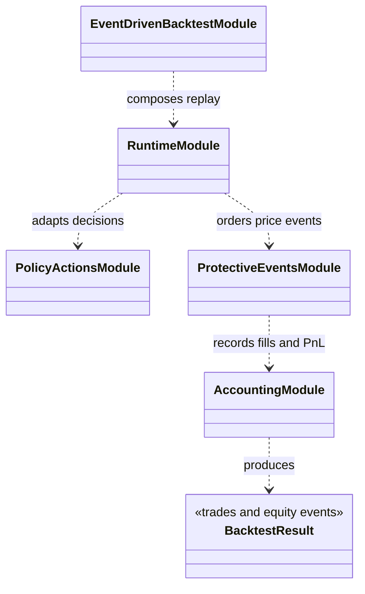

# Event-driven backtest

`simulation/backtest/` replays trading decisions through ordered market and
protective events. It is a distinct evaluation surface from the Gymnasium
environment: the backtest engine has its own event loop, accounting, policy
action adapter, and stop/target event processing.

## Components

- `event_driven_backtest.py` composes the event-driven run.
- `runtime.py` owns replay progression and orchestration helpers.
- `policy_actions.py` translates provider output into backtest intent.
- `protective_events.py` processes stop, target, and related price events.
- `accounting.py` records the account outcome.
- `cross_validation/` contains the separate walk-forward strategy evaluation
  path.

Inputs are market bars/features and a decision/strategy provider with declared
configuration. Outputs include event/trade records, account changes, and
metrics suitable for reporting. The event ordering and fill assumptions must
be read from the configured run and report; this engine is not a live broker
and is not interchangeable with the RL environment without parity evidence.

Tests live in `tests/integration/backtest/`, `tests/test_backtest/`, and
`tests/architecture/`.

## UML module view

