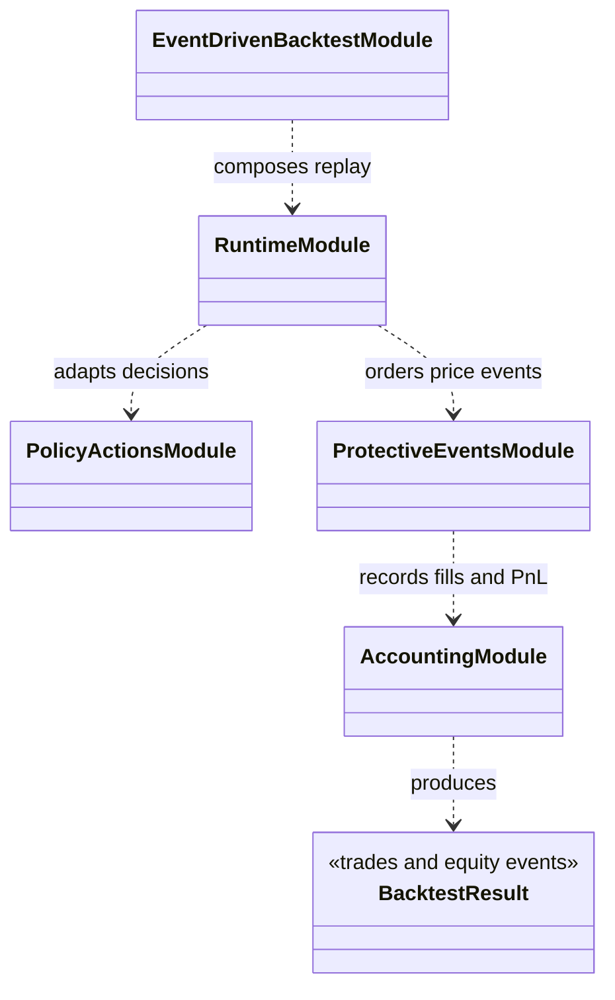

# Event-driven backtest

`simulation/backtest/` replays trading decisions through ordered market and
protective events. It is a distinct evaluation surface from the Gymnasium
environment: the backtest engine has its own event loop, accounting, policy
action adapter, and stop/target event processing.

## Components

- `event_driven_backtest.py` composes the event-driven run.
- `runtime.py` owns replay progression and orchestration helpers.
- `policy_actions.py` translates provider output into backtest intent.
- `protective_events.py` processes stop, target, and related price events.
- `accounting.py` records the account outcome.
- `cross_validation/` contains the separate walk-forward strategy evaluation
  path.

Inputs are market bars/features and a decision/strategy provider with declared
configuration. Outputs include event/trade records, account changes, and
metrics suitable for reporting. The event ordering and fill assumptions must
be read from the configured run and report; this engine is not a live broker
and is not interchangeable with the RL environment without parity evidence.
Config-driven market entries and market exits use `costs.slippage_points` as
adverse slippage for both tick and bar quotes. A caller can pass an explicit
`tick_fill_slippage_points=0.0` to replay zero-slippage historical fills.
Resting limit fills remain bounded by their limit price, and protective OHLC
fills keep their existing cost adjustment without a duplicate market charge.

## Policy evaluation boundary

The default policy API accepts one integer scalar signal per bar and remains in
use by configured scalar backtests and rule-baseline runners. With
`trade_setup_actions=True`, the engine accepts the versioned setup-action
vector, candidate mask, and explicit `TradeSetupActionSchema`. Its optional
`observation_schema` selects the legacy account vector, normalized account
state, or repeated-payout account schema for that callback; entry-state
visibility is rejected because this engine does not
run the environment's entry-state machine. Results include the resolved action
and observation schema metadata. Checkpoint evaluation and matched setup-policy
comparisons still use `evaluation.rollout.evaluate_model` with `TradingEnv`;
the event-backtest callback is not historical-checkpoint replay evidence.
Never cast a structured action vector to a direction signal, because that
would discard eligibility and selected controls.

There is no general bridge between a versioned `TradingEnv` policy and this
event loop. Any future cross-engine comparison must preserve the policy
observation and all active action/lifecycle coordinates, then pass paired
trace-level parity checks. Until such a bridge exists, results from the two
engines are comparable only when a declared scalar policy and matched
execution assumptions make the comparison meaningful.

The schema-aware path supports the legacy and normalized account schemas, the
current setup-action coordinates, and opt-in parity for completed-D1 regime features,
closed multi-timeframe windows, and per-feature validity channels. Returned
results record selected feature columns and observation inputs. Optional VAE
embeddings accept the same frozen encoder plus per-date or legacy pre-NY inputs
as `TradingEnv`. Entry-state-machine observations remain explicitly rejected:
the event loop does not run that lifecycle, and checkpoint evaluation uses
`TradingEnv`; a second partial state-machine implementation here would create
two sources of entry-state semantics. Account-vector and optional-channel
parity alone does not establish full cross-engine observation or execution
parity.

`run_backtest(..., eod_risk=...)` enables the shared configured intrabar
adverse-excursion close used by `TradingEnv`; `max_loss_per_trade_usd` remains
the sizing ceiling in that mode. Omitting `eod_risk` preserves the legacy
marked-open-PnL close cap for existing direct callers. This option aligns that
one position guard and does not establish full environment/backtest parity.
The configured `max_age_hours` close is also supported and has a paired
shared-tick trace for fill time, PnL, and ending equity. Stale-progress closure
is evaluated from the configured ATR progress threshold and stale-bar count at
an NY boundary where replay skips intervening rows. The paired shared-tick
synthetic trace covers this overnight-gap path; it does not establish broad
feed or live-account parity.

`run_backtest(..., sl_mode="breakeven")` applies the configured favorable-R
stop update after the bar's existing stop/target checks, so the new level first
affects the following bar. Static `trailing` mode additionally tightens the
stop against the completed bar's confirmed protective-side swing, using
`env.sl_buffer_pts`; it never loosens the stop or places it through the current
close. A mask-aware setup action schema can also carry learned per-position SL
and TP modes through market/limit submission and delayed fills. Its breakeven
and trailing TP updates take effect on the following bar, matching the
environment's no-retroactive-fill rule. This closes the mode-coordinate and
position-management slice, not full `TradingEnv` parity: optional observations,
complete account transitions, feed chronology, and the broader order lifecycle
still require paired evidence. Paired synthetic traces cover fixed,
breakeven, and confirmed-swing trailing stop modes.

`run_backtest(..., daily_pnl_basis=...)` selects the daily-loss accounting
contract used by account guardrails. Configured training and baseline runners
pass the resolved `trading_policy.daily_pnl_basis`; direct callers retain the
legacy closed-loss basis by default. Session net equity includes realized and
open PnL since the supplied `session_id` reset. Selecting that basis alone does
not enable payouts; a validated `trading_policy` in `repeated_payout` mode
enables the backtest payout/reset lifecycle and requires structure-based stop
levels. The lifecycle has narrow synthetic parity coverage, not a configured
market-data result or complete training/live parity.

Tests live in `tests/integration/backtest/`, `tests/test_backtest/`, and
`tests/architecture/`.

## UML module view

