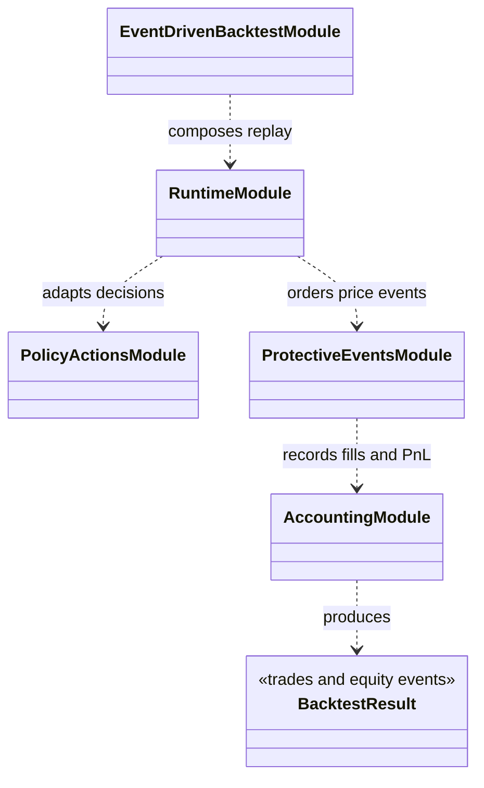

# Event-driven backtest

`simulation/backtest/` replays trading decisions through ordered market and
protective events. It is a distinct evaluation surface from the Gymnasium
environment: the backtest engine has its own event loop, accounting, policy
action adapter, and stop/target event processing.

## Components

- `event_driven_backtest.py` composes the event-driven run.
- `runtime.py` owns replay progression and orchestration helpers.
- `policy_actions.py` translates provider output into backtest intent.
- `protective_events.py` processes stop, target, and related price events.
- `accounting.py` records the account outcome.
- `cross_validation/` contains the separate walk-forward strategy evaluation
  path.

Inputs are market bars/features and a decision/strategy provider with declared
configuration. Outputs include event/trade records, account changes, and
metrics suitable for reporting. The event ordering and fill assumptions must
be read from the configured run and report; this engine is not a live broker
and is not interchangeable with the RL environment without parity evidence.

## Policy evaluation boundary

This engine accepts one integer scalar signal per bar. It is used by the
configured scalar backtest and rule-baseline runners. Checkpoint evaluation and
schema-versioned setup-policy comparisons use
`evaluation.rollout.evaluate_model` with `TradingEnv`; the matched setup
baseline runner gives every arm that same environment and validates the exact
action schema. Do not cast a structured action vector to a direction signal:
that would discard its setup eligibility, risk, stop/target, and exit
coordinates. The explicit rejection in `event_driven_backtest.py` protects
against that lossy comparison.

There is no general bridge between a versioned `TradingEnv` policy and this
event loop. Any future cross-engine comparison must preserve the policy
observation and all active action/lifecycle coordinates, then pass paired
trace-level parity checks. Until such a bridge exists, results from the two
engines are comparable only when a declared scalar policy and matched
execution assumptions make the comparison meaningful.

`run_backtest(..., eod_risk=...)` enables the shared configured intrabar
adverse-excursion close used by `TradingEnv`; `max_loss_per_trade_usd` remains
the sizing ceiling in that mode. Omitting `eod_risk` preserves the legacy
marked-open-PnL close cap for existing direct callers. This option aligns that
one position guard and does not establish full environment/backtest parity.
The configured `max_age_hours` close is also supported and has a paired
shared-tick trace for fill time, PnL, and ending equity. Stale-progress closure
is evaluated from the configured ATR progress threshold and stale-bar count at
an NY boundary where replay skips intervening rows. The paired shared-tick
synthetic trace covers this overnight-gap path; it does not establish broad
feed or live-account parity.

`run_backtest(..., sl_mode="breakeven")` applies the configured favorable-R
stop update after the bar's existing stop/target checks, so the new level first
affects the following bar. Static `trailing` mode additionally tightens the
stop against the completed bar's confirmed protective-side swing, using
`env.sl_buffer_pts`; it never loosens the stop or places it through the current
close. Learned per-action stop-mode vectors remain on the `TradingEnv`
evaluation path and are not supported by this scalar event engine. Paired
synthetic traces cover fixed, breakeven, and confirmed-swing trailing modes.

`run_backtest(..., daily_pnl_basis=...)` selects the daily-loss accounting
contract used by account guardrails. Configured training and baseline runners
pass the resolved `trading_policy.daily_pnl_basis`; direct callers retain the
legacy closed-loss basis by default. Session net equity includes realized and
open PnL since the supplied `session_id` reset. Selecting that basis alone does
not enable payouts; a validated `trading_policy` in `repeated_payout` mode
enables the backtest payout/reset lifecycle and requires structure-based stop
levels. The lifecycle has narrow synthetic parity coverage, not a configured
market-data result or complete training/live parity.

Tests live in `tests/integration/backtest/`, `tests/test_backtest/`, and
`tests/architecture/`.

## UML module view

