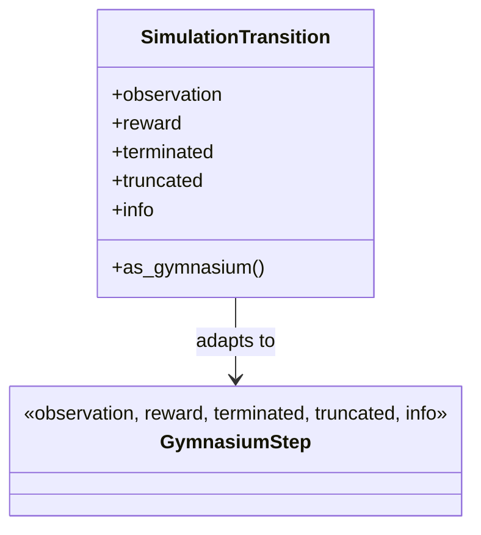

# Simulation contracts

This package contains the framework-neutral value returned by one simulator
transition. `SimulationTransition` holds the next observation, scalar reward,
termination and truncation flags, and transition metadata. Its
`as_gymnasium()` adapter returns the standard five-element Gymnasium tuple.

The contract lets simulation logic describe what happened without coupling
that result to a specific learner. It does not define observation/action
semantics, account models, or policy behavior; those are owned by
`decisioning/`, `trading/`, and `learning/`.

The contract is covered by simulator and architecture tests under `tests/`.

## UML module view

