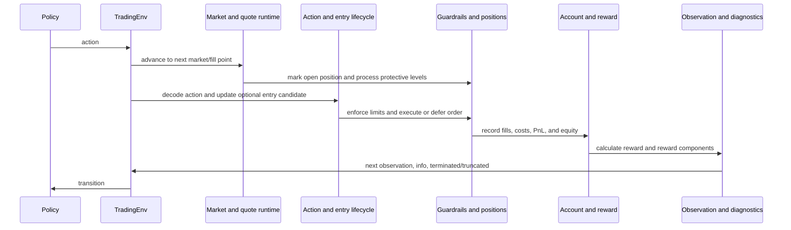
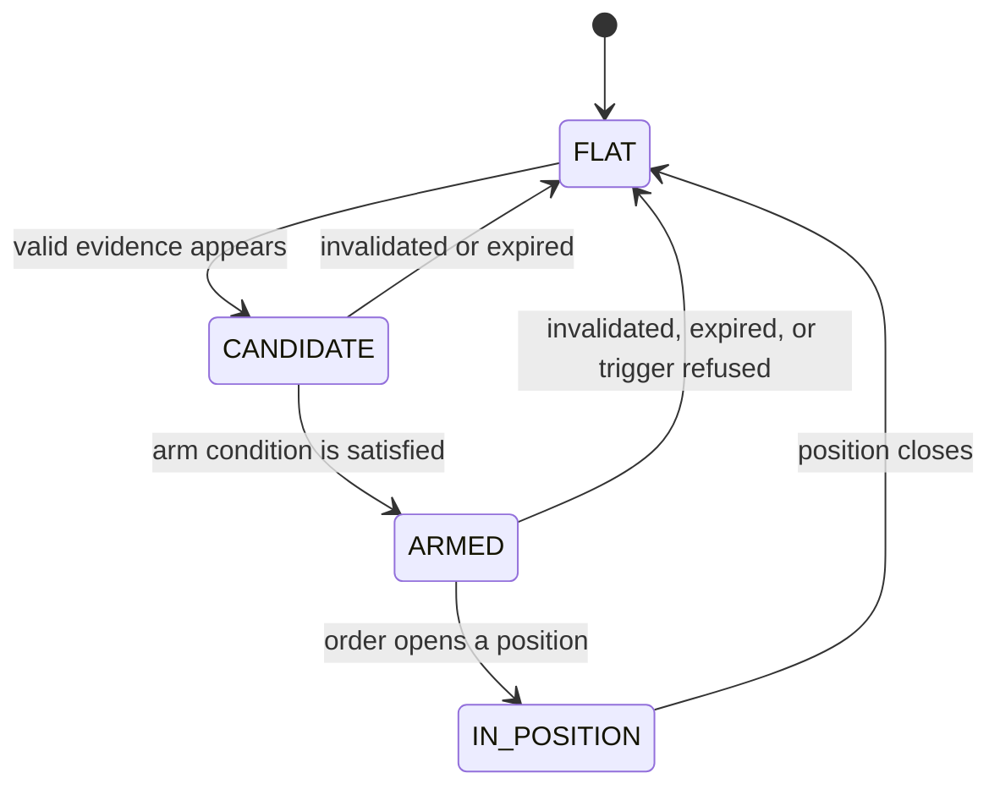

# Trading environment

The environment advances one decision point at a time. It does more than map
an action to a trade: it advances market/account state, handles fills and
protective exits, enforces risk rules, calculates reward, then returns the
next observation and diagnostics.

## Ownership

The environment owns the simulated transition lifecycle. It composes focused
initialization, market-access, risk, action-decoding, entry, execution,
position-management, observation, reward, and episode services. It consumes
data and feature rows prepared by upstream packages; it does not fit feature
normalizers, train a policy, or place real broker orders.

## One environment step

The actual step order is important for causal execution and is implemented in
`EpisodeRuntimeMixin._step_untraced`:

The simulator advances/marks the market before applying the current policy
action. A new order then uses its configured fill point and quote source. This
ordering prevents a newly opened position from being stopped by price movement
that occurred before its entry fill.

## Runtime groups

| Concern | Runtime components | Responsibility |
|---|---|---|
| Environment boundary | `env.py`, `spec.py`, `market_view.py` | Public constructor, transition adapter, typed market views |
| Initialization | `initialization_runtime.py` and `*_initialization.py` | Load market arrays, account/risk settings, strategies, reward, action and observation spaces |
| Market advancement | `market_access.py`, `episode_runtime.py`, `tick_quote_runtime.py` | Select bars, advance sessions, resolve tick quotes, mark equity |
| Decision | `action_runtime.py`, `action_intent_runtime.py`, `entry_state.py` | Decode discrete/continuous/structured actions and track optional entry candidates |
| Entry lifecycle | `entry_runtime.py`, `entry_order_runtime.py`, `entry_execution_runtime.py`, `position_open_runtime.py` | Select entry levels, size, execute, and log opening decisions |
| Guardrails | `risk_runtime.py`, `step_constraints_runtime.py` | Enforce daily, maximum, and optional trailing constraints; reject or terminate safely |
| Open position | `position_runtime.py`, `protective_level_runtime.py`, `ema_exit_runtime.py` | Update stops, evaluate targets, take partial exits, and close positions |
| Accounting and reward | `trade_accounting_runtime.py`, `step_accounting_runtime.py`, `rewards.py`, reward modules | Reconcile fills, account equity, reward, and reward parts |
| Observation and evidence | `observation_runtime.py`, `observations.py`, `step_info_runtime.py`, diagnostics modules | Build model inputs and per-step/episode diagnostics |
| Step completion | `step_end_runtime.py`, `episode_runtime.py` | Advance decision index and set termination or truncation reason |
| Shared data bundles | `bundles.py`, `shared_bundle.py`, `worker.py` | Reusable immutable input arrays for parallel environment workers |

Names are grouped by runtime responsibility rather than alphabetically. The
`TradingEnv` facade composes these services; most individual mixins are
implementation details rather than public APIs.

## Environment composition UML

This diagram follows the real `TradingEnv` inheritance/composition boundary.
The mixins divide the transition lifecycle; they are not separate environment
instances or policy components.

```mermaid
classDiagram
    class TradingEnv
    class InitializationRuntimeMixin
    class MarketAccessMixin
    class RiskRuntimeMixin
    class ExecutionRuntimeMixin
    class ActionDecodingMixin
    class EntryExecutionRuntimeMixin
    class EntryRuntimeMixin
    class DiagnosticsRuntimeMixin
    class StepRuntimeMixin
    class EpisodeRuntimeMixin
    class PositionRuntimeMixin
    class ObservationRuntimeMixin
    class RuntimeMixinBase
    class TradingStrategy
    class TickBook
    class SimulationTransition
    TradingEnv --|> InitializationRuntimeMixin
    TradingEnv --|> MarketAccessMixin
    TradingEnv --|> RiskRuntimeMixin
    TradingEnv --|> ExecutionRuntimeMixin
    TradingEnv --|> ActionDecodingMixin
    TradingEnv --|> EntryExecutionRuntimeMixin
    TradingEnv --|> EntryRuntimeMixin
    TradingEnv --|> DiagnosticsRuntimeMixin
    TradingEnv --|> StepRuntimeMixin
    TradingEnv --|> EpisodeRuntimeMixin
    TradingEnv --|> PositionRuntimeMixin
    TradingEnv --|> ObservationRuntimeMixin
    ActionDecodingMixin --|> RuntimeMixinBase
    EntryRuntimeMixin --|> RuntimeMixinBase
    EpisodeRuntimeMixin --|> RuntimeMixinBase
    RiskRuntimeMixin --|> RuntimeMixinBase
    PositionRuntimeMixin --|> RuntimeMixinBase
    ObservationRuntimeMixin --|> RuntimeMixinBase
    TradingEnv --> TradingStrategy : optional strategy
    TradingEnv --> TickBook : optional tick quotes
    EpisodeRuntimeMixin --> SimulationTransition : returns
```

## Entry opportunity state

When the optional entry state machine is enabled, an opportunity follows this
causal lifecycle:

The implementation's states are `FLAT`, `CANDIDATE`, `ARMED`, and
`IN_POSITION`. A candidate captures its origin bar and a snapshot of setup
levels. Age, invalidation, retest requirements, and successful execution
control its transition. A position itself remains owned by the trading
position/account contracts; the entry state machine records the opportunity
lifecycle.

## Observation and action boundary

The observation is a mapping with a sequence window and mask, account state,
and optional regime or multi-timeframe branches. Additional branches may
include entry eligibility. Coordinate meanings are versioned; vector width
alone does not define semantics. See the
[observation reference](../../docs/reference/observation_schemas.md) and
[action reference](../../docs/reference/action_schemas.md).

Actions may be discrete, scalar continuous, or a versioned structured overlay.
The decoder validates coordinate width and finiteness, maps the selected
direction/risk/stop/target/management controls to an intent, then the entry
runtime validates it against market context and configured limits. The action
does not itself represent an order or a fill.

## Execution and accounting

Execution uses configured spreads and cost model, bar-open quotes or tick
quotes, optional fill delay/latency, and stop/target-specific fill handling.
Positions carry entry, size, stop/target, and management state. Partial target
fills update position size and realized account equity. Each step records the
equity path and calculates the selected reward mode; reward attribution is
returned as diagnostics. These choices define the simulation, not universal
broker behavior.

## Configuration

The primary settings are declared in `config/base/default.yaml` and resolved
by the training/evaluation composition roots. They include account limits,
cost and tick execution, observation windows, action schema flags, reward
mode, optional entry-state behavior, and episode limits. Use the configuration
loader and variant resolver rather than constructing divergent settings by
hand.

## Inputs, outputs, and failures

**Inputs:** chronologically aligned bars and features; optional tickbook;
session/pre-session context; account, risk, cost, and action configuration.

**Outputs:** next observation, reward, `terminated`, `truncated`, transition
info, trade events, equity points, and diagnostics.

Malformed action dimensions or non-finite values fail explicitly. Entry
requests can be rejected by missing/invalid context, risk limits, session
constraints, execution timing, unavailable required tick data, or protective
level validation. Rejections and their reasons are recorded so they can be
distinguished from a policy choosing to hold.

## Tests

Relevant coverage is under `tests/unit/simulation/test_environment/`,
`tests/unit/models/`, `tests/unit/learning/`, and
`tests/integration/backtest/`. Architecture tests protect package dependency
direction and the backend-neutral transition surface.
