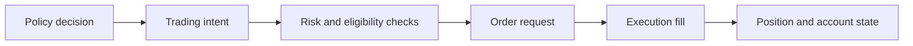

# Trading domain

`trading/` contains broker-neutral account, order, position, risk, quote, and
strategy concepts. It describes trading state and decisions without depending
on a specific RL backend or broker API.

| Area | Owns |
|---|---|
| `account/` | Balance, equity, session anchors, and account state. |
| `orders/`, `positions/` | Proposed and open trade state. |
| `execution/`, `quotes/` | Broker-neutral fill and quote contracts. |
| `risk/` | Position and account risk calculations/guardrails. |
| `strategies/` | Strategy interfaces consumed by replay and live runtimes. |

Subsystem guides: [orders](orders/README.md), [execution](execution/README.md),
and [risk](risk/README.md).

The trading domain should not import `simulation/`; simulation implements one
historical execution mechanism using these contracts. Broker-specific
translation belongs in `integrations/`. Changes to sizing, stop, or limit
semantics need unit tests and matched environment/backtest/live adapter review.

## Decision-to-fill boundary

Each object has a different status: a policy may request an action, the domain
may resolve it to an intent, risk may reject it, an order may be submitted,
and execution may return a partial or complete fill. Reports must not describe
an action request as an opened trade. Account state tracks realized and
unrealized outcomes under the selected valuation convention.

## Extension and verification

Add broker-neutral value objects and protocols here; translate vendor-specific
units, timestamps, and status codes at adapter boundaries. Keep risk rules
explicit about currency, equity base, and rounding. Focused tests are under
`tests/unit/trading/`; simulation and live integration tests check that
adapters preserve the same domain meaning.

See the [trading guide](../docs/modules/trading.md),
[risk concept](../docs/concepts/risk_and_account_limits.md), and
[execution concept](../docs/concepts/execution_and_costs.md).
