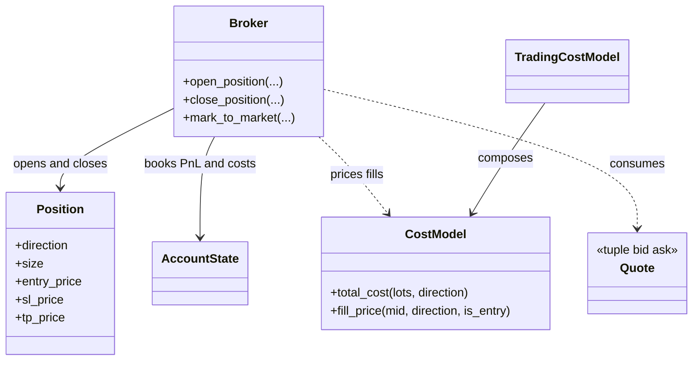

# Execution and transaction costs

`trading/execution/` defines broker-neutral quote, fill, position, and cost
behavior used by simulation and adapters. It owns the mapping from a requested
side to an executable bid or ask price. It does not decide whether a policy
should trade or which structural level should be selected.

## Quote and fill contract

Quotes are `(bid, ask)` pairs and must be finite, positive, and non-crossed.
Long entries use ask and long exits use bid; short entries use bid and short
exits use ask. Mark-to-market uses the close-side quote. `Broker` mutates
`AccountState` and `Position` from accepted fills. `CostModel` represents spread,
slippage, commission, point value, and point size; spread/slippage embedded in
fill prices are not added again as explicit fees.

## Configuration and limits

The resolved execution configuration selects bar or tick quotes, spread and
slippage assumptions, commissions, fill delay, and any stop/target-specific
fill rule. A tick-required run must refuse missing executable quotes instead of
silently inventing a fill. Intrabar bar replay cannot establish the exact price
path between observations; tick fills are still bounded by tick coverage and
the configured simulator assumptions.

## Extension and verification

Add venue-specific translation in an integration adapter, not to `Broker`.
Test long/short entry and exit sides, invalid quotes, partial closes, cash/equity
reconciliation, and cost accounting. Focused tests are under
`tests/unit/trading/`, `tests/unit/simulation/`, and `tests/integration/backtest/`.
See [execution and costs](../../docs/concepts/execution_and_costs.md).
