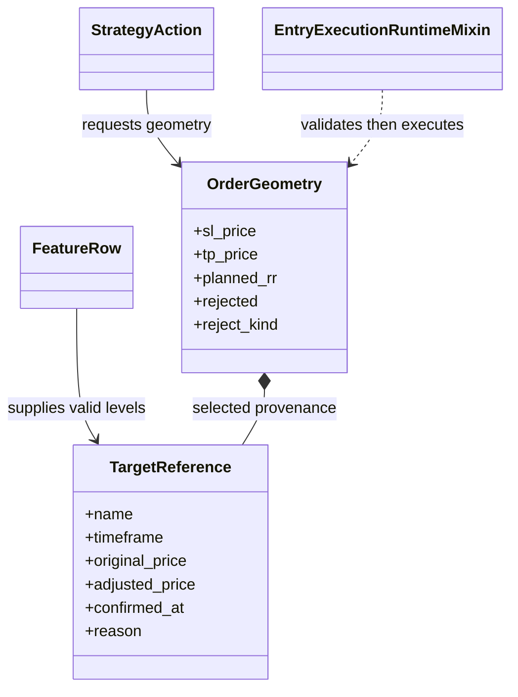

# Order intent and structural levels

`trading/orders/` turns a strategy's direction and risk request into candidate
entry geometry: an entry price, invalidation stop, and one or more target
references. These are proposed levels. The simulation or broker execution
boundary still decides whether and where an order fills.

## Order construction

`TargetReference` carries the selected target's source timeframe, original and
adjusted prices, confirmation time, and reason. `OrderGeometry` carries the
resolved stop, target, planned reward-to-risk, source references, and an
explicit rejection outcome. Stop and target selectors use active feature-row
references and timeframe provenance; they must not pull future or invalidated
levels into a new order.

## Configuration and invariants

The selected variant controls structural references, stop modes, target slots,
and optional management behavior. A valid stop must be on the loss side of the
entry and a valid target on the profit side. If an entry idea has a setup
timeframe, structural stop eligibility is checked against that selected setup
timeframe; target references may follow the configured target-selection rule.
EMA management is not a first target: it applies only after the configured
partial target has been reached.

## Extension and verification

Add new candidate types with explicit timeframe, validity, and causal
availability. Preserve the distinction between a candidate level, selected
order geometry, accepted order, and actual fill. Tests under `tests/unit/trading/`
cover selectors and sizing; environment tests cover the end-to-end decision.
See the [trading](../../docs/modules/trading.md) and
[market-structure](../../docs/concepts/market_structure.md) guides.
