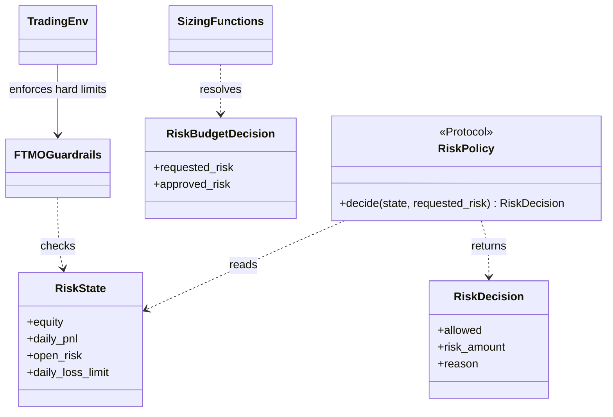

# Risk budgets and guardrails

`trading/risk/` converts a trade's proposed stop and size into a monetary risk
amount, then evaluates that request against account and execution constraints.
It supplies broker-neutral policy contracts; the simulation environment and
broker adapters decide when to enforce them.

## Core contracts

`RiskState` carries current equity, daily PnL, open risk, and the daily limit.
`RiskPolicy` returns a `RiskDecision` with an allow/deny result, approved risk,
and reason. `RiskBudgetDecision` represents the resolved budget. Sizing helpers
calculate stop-loss exposure, lots, structural levels, and an optional
execution reserve. `FTMOGuardrails` is an environment-facing implementation of
the account loss floors; it is a hard backstop, separate from any learned
penalty.

## Configuration and invariants

Dollar and equity-fraction settings are resolved from the account, risk, and
environment configuration in `config/base/default.yaml` plus the selected
variant. A stop price, position size, contract size, point value, currency,
rounding, and modeled execution reserve must use consistent units. Risk
calculation must not double-count spread or slippage already reflected by the
fill price. The learned policy cannot override hard account floors.

## Extension and verification

Keep new risk rules behind explicit contracts, state their units and equity
base, and preserve the same semantics in simulation, backtest, and broker
adapters. Tests belong under `tests/unit/trading/` and the environment tests
under `tests/unit/simulation/`. See [risk and account limits](../../docs/concepts/risk_and_account_limits.md)
and the [trading module guide](../../docs/modules/trading.md).
