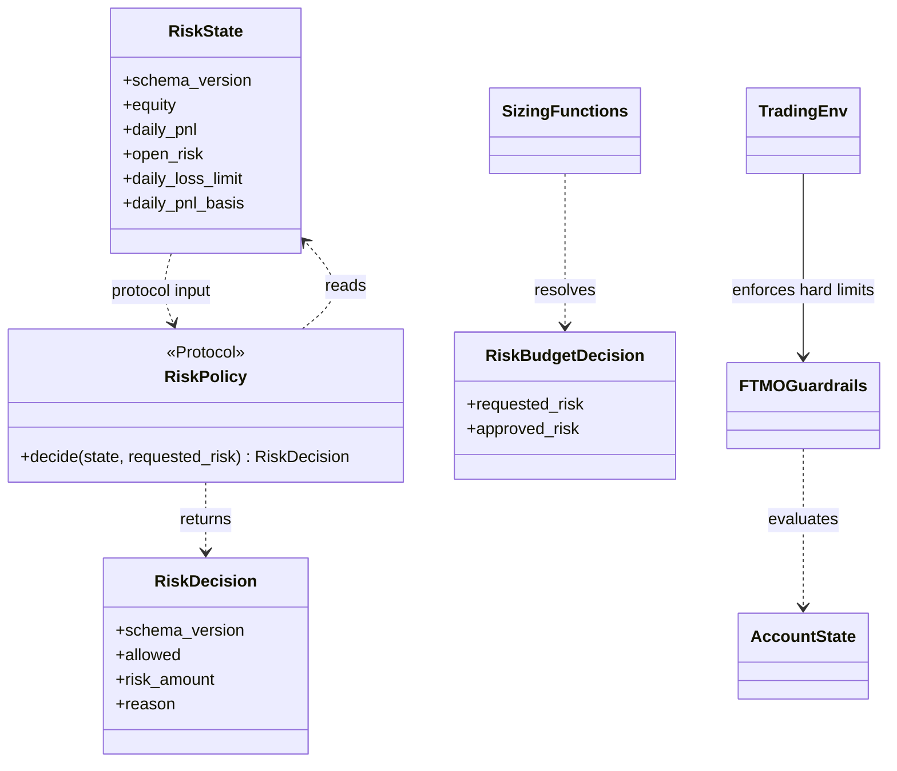

# Risk budgets and guardrails

`trading/risk/` provides sizing helpers, account guardrails, and broker-neutral
risk decision contracts. The current simulation and backtest runtimes use
`AccountState`, `FTMOGuardrails`, and sizing helpers. Daily hard and soft
guardrail checks read the selected daily-PnL basis through
`AccountState.to_risk_state()`; neither runtime currently calls
`RiskPolicy.decide()` for entry approval. Live risk is adapted through the
MT5 runtime. These shared account inputs and synthetic transition tests do
not establish full cross-backend risk parity.

## Core contracts

`RiskState` v1 carries current equity, signed daily PnL (profit positive, loss
negative), committed open risk, the daily loss limit, and an explicit PnL
basis, all monetary values in account currency. `session_net_equity` means
current equity minus session-start equity, including unrealized PnL;
`legacy_gross_closed_losses` means the negative sum of losing closes, without
offsetting gains or unrealized PnL. Consumers must preserve the basis rather
than treating those quantities as interchangeable. Its `schema_version` is
`risk-state-v1`. `RiskPolicy` returns a `RiskDecision` v1 with an
allow/deny result, approved risk, and reason; denied decisions approve zero
risk. Its `schema_version` is `risk-decision-v1`. `RiskBudgetDecision`
represents the resolved budget. Sizing helpers
calculate stop-loss exposure, lots, structural levels, and an optional
execution reserve. `FTMOGuardrails` is an environment-facing implementation of
the account loss floors; it is a hard backstop, separate from any learned
penalty.

The shared `adverse_position_loss_limit_usd` helper computes the environment's
intrabar adverse-excursion cutoff, including its optional planned-stop-risk
floor. `run_backtest` can consume the same `eod_risk` settings explicitly;
callers that omit them retain a legacy marked-open-PnL close cap. Other
position-management and live-broker behaviors remain separate contracts and
require their own parity evidence.

## Configuration and invariants

Dollar and equity-fraction settings are resolved from the account, risk, and
environment configuration in `config/base/default.yaml` plus the selected
variant. A stop price, position size, contract size, point value, currency,
rounding, and modeled execution reserve must use consistent units. Risk
calculation must not double-count spread or slippage already reflected by the
fill price. The learned policy cannot override hard account floors.

## Extension and verification

Keep new risk rules behind explicit contracts, state their units and equity
base, and preserve the same semantics in simulation, backtest, and broker
adapters. Tests belong under `tests/unit/trading/` and the environment tests
under `tests/unit/simulation/`. See [risk and account limits](../../docs/concepts/risk_and_account_limits.md)
and the [trading module guide](../../docs/modules/trading.md).
