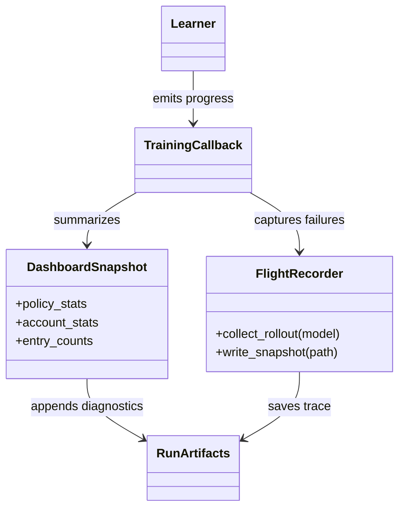

# Training diagnostics and callbacks

`training/callbacks/` observes learner and environment progress and writes
diagnostics that help detect invalid updates, policy collapse, and run-health
problems. A callback is an observer or recovery aid; it must not silently
change account-risk semantics or make a training score stand in for an
evaluation result.

## Components

The dashboard converts current learner and environment statistics into
readable snapshots and append-only rows. The debug trace contains rollout
summaries and built-in checks. `FlightRecorder` records bounded diagnostic
state for failures. Callback setup is composed by training and should be
configured from the resolved run settings.

## Configuration and limits

Logging cadence, diagnostic thresholds, and output paths come from the
resolved training configuration and callback setup. Keep expensive captures
bounded and keep random-number-generator state unchanged when diagnostics
inspect a policy. Metrics should include their units and distinguish
environment counters from learner optimization statistics.

## Extension and verification

Add a diagnostic when it answers a concrete failure or behavior question;
prefer a tested summary over storing unbounded per-step objects. Tests live in
`tests/unit/training/` and `tests/unit/learning/`. See the
[training guide](../../docs/modules/training.md) and
[run tutorial](../../docs/how-to/run_training.md).
