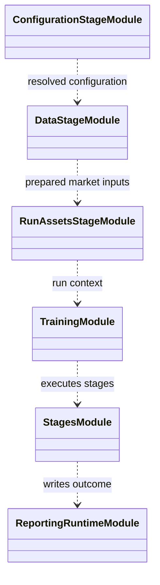

# Training runner

The runner is the composition root for training stages. It resolves settings,
verifies data and features, prepares run assets and workers, invokes the
learner, records diagnostics, and writes recoverable artifacts.

Each stage should have explicit inputs and outputs so a resumed run does not
silently rebuild incompatible caches or change its resolved settings. Keep
worker process mechanics separate from research configuration, and persist
the information needed to reconstruct model and environment schemas.

See [`training/README.md`](../README.md),
[training runtime](../../docs/architecture/runtime/training.md), and
[run how-to](../../docs/how-to/run_training.md).

## UML module view

