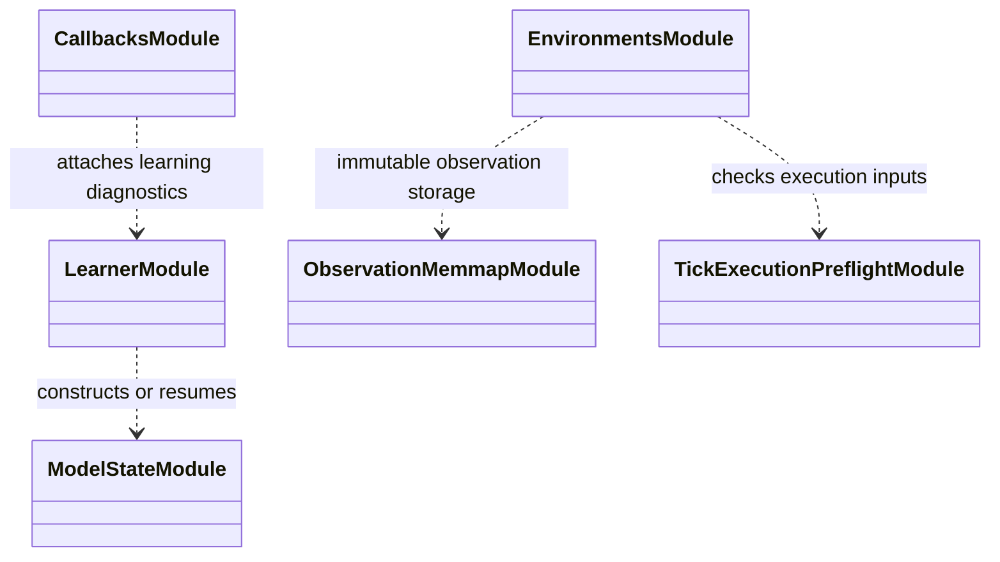

# Training setup

`training/setup/` constructs the objects required before the learning loop:
resolved market/features, simulation environments, callbacks, and run-specific
learner inputs. It is setup composition, not the owner of feature semantics,
account execution, or algorithm updates.

Construction should use the resolved configuration and run identity produced
by the runner. Environment workers must receive equivalent risk, action,
observation, cost, and execution settings; shared input arrays may be reused
only when they are immutable. Keep worker transport/parallelism separate from
research settings so resource tuning does not silently change experiment
meaning.

Focused tests live under `tests/unit/training/` and
`tests/unit/simulation/`; worker-start and checkpoint behavior also have
integration coverage. When changing setup, test both construction arguments
and the first real environment transition. See the [training guide](../README.md)
and [training runtime](../../docs/architecture/runtime/training.md).

## UML module view

